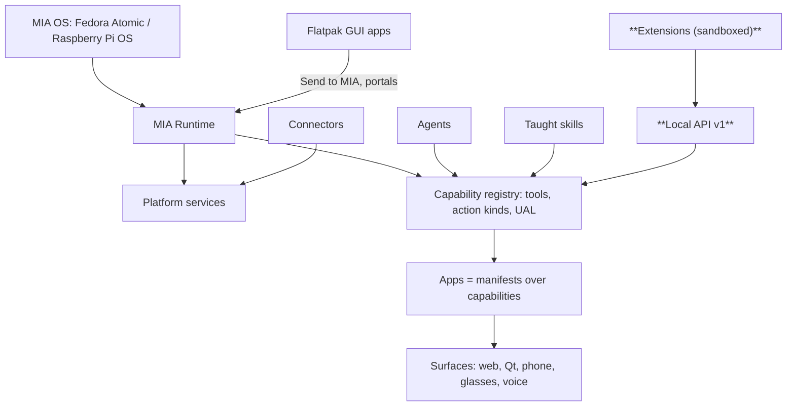
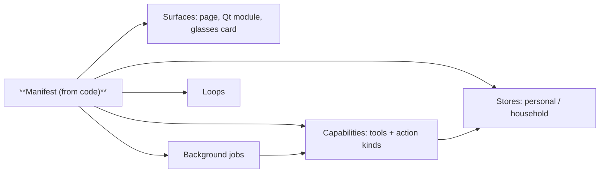
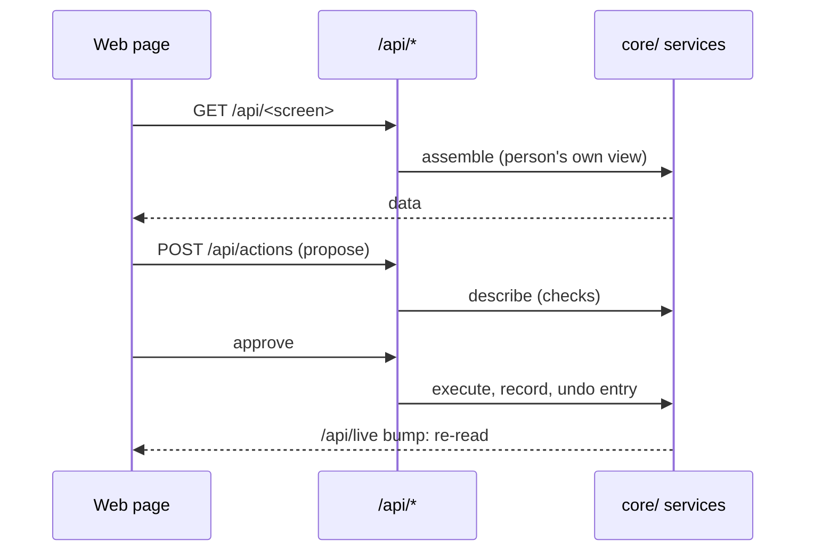
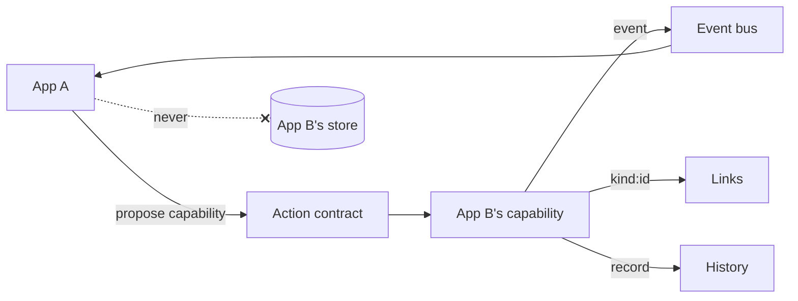
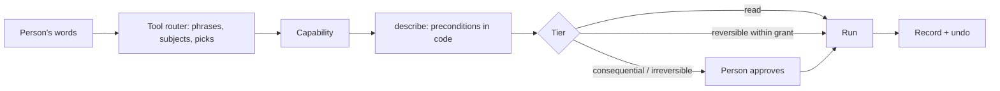
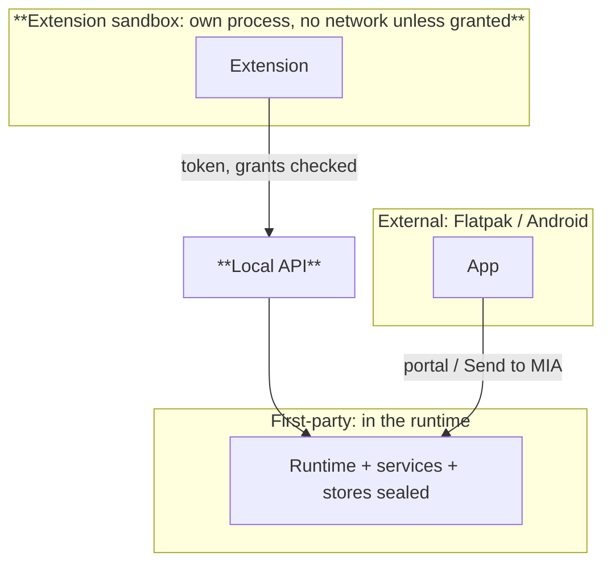
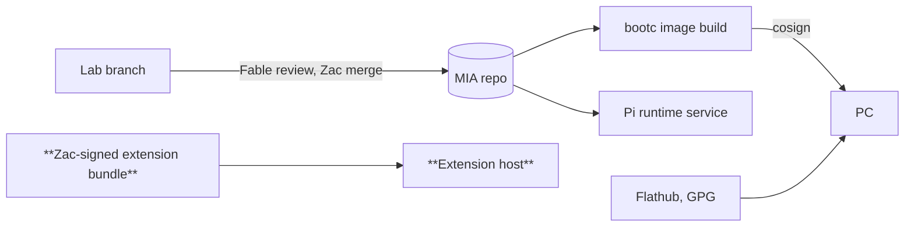
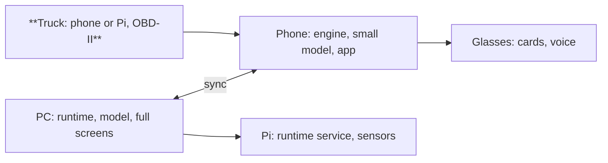
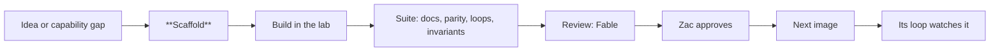

# MIA OS: application architecture diagrams (Prompt 03 §19)

*Claude (Opus), 2026-11-15. Mermaid source. **Bold** labels are proposed; the rest exists.*

## 1. Application ecosystem overview



## 2. One application's internal structure



## 3. Lifecycle

```mermaid
stateDiagram-v2
  [*] --> Developed: lab worktree
  Developed --> Validated: suite, review (Fable)
  Validated --> Installed: Zac approves the merge / image
  Installed --> Available: services and stores load
  Available --> Running: surface open or job ran
  Running --> Degraded: a part missing
  Degraded --> Running: recovered
  Running --> Failed: error on last use
  Failed --> Available: fixed or reconnected
  Available --> Disabled: hidden by the person
  Disabled --> Available
  Installed --> RolledBack: previous image
```

## 4. App to platform



## 5. App to app



## 6. MIA's intelligence invoking a capability



## 7. Security boundaries



## 8. Distribution



## 9. Multi-device



## 10. Developer workflow


