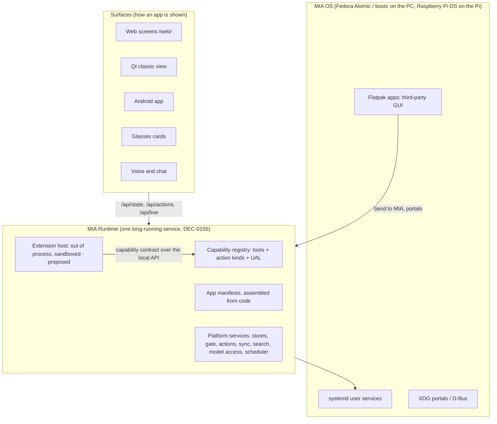

# MIA OS: the application framework (Prompt 03)

*Prompt 04 (2026-11-15): requirements now live in [MIA_OS_SYSTEM_REQUIREMENTS.md](MIA_OS_SYSTEM_REQUIREMENTS.md) and [MIA_OS_FUNCTIONAL_REQUIREMENTS.md](MIA_OS_FUNCTIONAL_REQUIREMENTS.md); what the OS and platform must provide the framework is section C there.*

*Zac's review (2026-11-15): DEC-0175 approved as the direction of his handoff (prompt 22, planned in
[MIA_OS_APPLICATION_REGISTRY.md](MIA_OS_APPLICATION_REGISTRY.md)); DEC-0176 approved; DEC-0177 approved with his
clarification (MIA first-class in the image; MIA-native apps by the runtime, never Flatpak; conventional apps by
Flatpak); no app store.*

*Claude (Opus), 2026-11-15. Planning only: nothing here is built. The prompt is
[`prompts/03_MIA_OS_NATIVE_APPLICATION_ECOSYSTEM_APPLICATION_FRAMEWORK.md`](prompts/03_MIA_OS_NATIVE_APPLICATION_ECOSYSTEM_APPLICATION_FRAMEWORK.md).
This is the summary document; the other sixteen Prompt 03 documents go deeper on one part each (index in section 9).
The proposed decisions are DEC-0175 to DEC-0177. Fable reviews this work (DEC-0174).*

## 1. The finding that shapes everything

**MIA already has an application framework; it's capability-first, not app-first.** What MIA invokes is not an app
but a capability: a tool (419 of them, in 88 domains, `core/assistant_actions.py`) and an action kind (466, in 139
families, `core/actions.py`), and since 2026-11-15 the Universal Action Layer's actions on a selection (`core/ual.py`).
An "app" is the person-facing bundle over those: an entry in `core/web_surfaces.APPS` (56) naming its page, its tool
domains and its area, optionally a Qt module (35, discovered by `core/module_manager.py`), stores in
`core/personal_data.py` (49 personal, 42 household), jobs in `core/background_jobs.py`, a glasses card, and its
parity row (`core/parity.py`). The rules that make this one system are already enforced by tests: one-way layering
(CLAUDE.md), every action both a tool and a control (DEC-0125, `tests/test_parity.py`), every store under the atomic
write and undo, every process under a loop (`tests/test_loop_coverage.py`), every file documented.

So the framework this prompt asks for is mostly **naming and formalising what exists**, plus four real gaps:
1. **One manifest per app.** Its parts are declared in five places that agree by tests, not in one record.
2. **Declared side effects and permissions per capability.** Tools and actions declare inputs and a sentence to
   approve, but not a tier, reversibility, network, devices or data touched as fields (DEC-0156 grants: Fable).
3. **Out-of-process and third-party code.** Every app runs inside MIA's process with full privileges (R-04); a
   module installed from "Add Module" isn't sandboxed (CLAUDE.md says so).
4. **App status.** MIA can't yet say "Finance is installed but failing to load" from one place.

## 2. The recommended architecture

- **First-party apps stay in-process in the MIA Runtime**, as today: same Python engine, same stores, same action
  contract. Splitting each into its own process buys isolation MIA doesn't need for its own code and costs every
  cross-app join (the life state, relevance, links) a network hop. (DEC-0175.)
- **Each app gets one manifest, assembled from code** (`App` + its tool domains + its action families + its stores +
  its jobs + its surfaces + its devices), never hand-written twice (AF-1). Proposed `core/app_manifest.py`.
- **Capabilities declare their contract as fields** (MIA_OS_AI_APPLICATION_INTEGRATION.md): inputs, outputs, tier
  (read, prepare, reversible act, consequential, irreversible), undo, network, devices, data touched, timeout,
  cancellation. Enforced by DEC-0156's grants (Fable).
- **Code that isn't MIA's own runs out of process**: an extension host that runs each extension in its own sandboxed
  process (bubblewrap or `systemd-run` with a restrictive profile), reaching MIA only through the capability contract
  over the runtime's local API. (DEC-0176.) Until it exists, only first-party and lab-built code (merged on Zac's
  approval, DEC-0058) runs.
- **Ordinary Linux GUI apps are Flatpaks** (Fedora Atomic's main way to install apps), sandboxed by Flatpak and the
  portals. They reach MIA through Send to MIA (the UAL) and, later, a portal-style MIA D-Bus service with grants.
  (DEC-0177.)
- **Android apps** stay on the phone's own Android (DEC-0168); Waydroid on the PC is optional, not part of the
  framework.

## 3. How the prompt's sections are answered (where to read)

| Prompt section | Answer, in short | Document |
|---|---|---|
| 2 Application model | eleven kinds; the capability is the unit; an app is a bundle of surfaces over capabilities | MIA_OS_APPLICATION_MODEL.md |
| 3 Internal structure | manifest + surfaces + capabilities + stores + jobs; template from the module spec | MIA_OS_APPLICATION_MODEL.md |
| 4 Lifecycle | sixteen stages mapped; status from one place (proposed) | MIA_OS_APPLICATION_LIFECYCLE.md |
| 5 Discovery and launching | Apps, Search, the eight destinations, voice, the UAL, intents → capabilities | MIA_OS_APPLICATION_LIFECYCLE.md §5 |
| 6 Platform APIs | the services catalogue with contracts; versioning | MIA_OS_APPLICATION_API_ARCHITECTURE.md |
| 7 App-to-app | actions, events, links, the history; never imports | MIA_OS_APPLICATION_INTEROPERABILITY.md |
| 8 AI integration | capability declarations, intent → capability, tiers and approval | MIA_OS_AI_APPLICATION_INTEGRATION.md |
| 9 Data | personal / household / device stores, sealing, sync, backup, undo, schema versions | MIA_OS_APPLICATION_DATA_AND_PERSISTENCE.md |
| 10 Security | grants, trust levels, sandboxing out of process, Flatpak and portals | MIA_OS_APPLICATION_SECURITY_REQUIREMENTS.md |
| 11 Distribution | MIA in the image; Flatpak for GUI apps; signed extensions; no marketplace now | MIA_OS_APPLICATION_DISTRIBUTION_AND_UPDATES.md |
| 12 Developer experience | the module spec, validator, tests, lab, a scaffold (proposed) | MIA_OS_APPLICATION_DEVELOPER_FRAMEWORK.md |
| 13 Extensions | what an extension is versus a module, connector, skill, agent; out of process | MIA_OS_APPLICATION_EXTENSION_ARCHITECTURE.md |
| 14 Background | jobs declared, homeostasis, honest status | MIA_OS_APPLICATION_LIFECYCLE.md §6 |
| 15 Multi-device | one app, many surfaces (option 1), parity per device | MIA_OS_MULTI_DEVICE_APPLICATION_MODEL.md |
| 16 UX integration | the frame (`web/shell.js`), tokens, OS-owned vs app-owned | MIA_OS_MULTI_DEVICE_APPLICATION_MODEL.md §4 |
| 17 Compatibility | API and store versions, deprecation, compatibility tests | MIA_OS_APPLICATION_COMPATIBILITY_MODEL.md |
| 18 Research | Flatpak, portals, D-Bus, systemd, namespaces, LSMs, containers, Waydroid, signing | MIA_OS_APPLICATION_TECHNOLOGY_EVALUATION.md |
| 19 Diagrams | ten Mermaid diagrams | MIA_OS_APPLICATION_ARCHITECTURE_DIAGRAMS.md |
| 21 Decisions | DEC-0175 to DEC-0177, below | this document §5 |
| 22 Acceptance | per criterion, with evidence or a test to write | MIA_OS_APPLICATION_FRAMEWORK_ACCEPTANCE_CRITERIA.md |

## 4. Existing infrastructure mapped onto the framework

| Framework part | Exists | Adapt | Stays independent |
|---|---|---|---|
| App catalogue | `core/web_surfaces.APPS`, `core/web_areas.py` (destinations), `/api/shell` | gains the manifest's other fields | — |
| Capability registry | tool registry, `ACTION_TYPES`, UAL catalogue, `core/capabilities.py` (built from code) | declared fields (tier, undo, network, devices) | — |
| Module loading | `core/module_manager.py`, `core/module_validator.py` | none (Qt is the classic view, DEC-0168: fixes only) | the Qt modules |
| Platform services | `AppContext` fields, `core/runtime.build_services` | a versioned local API for out-of-process callers | — |
| Data | personal / household / device stores, at-rest sealing, sync, backups, undo | per-store schema versions (T-03) | the homestead subproject (own repo history, own DB) |
| Permissions | the action contract's approval, `browser_safety`, child gating, UAL tiers, taught-skill gates | DEC-0156 grants | — |
| Background | `core/background_jobs.py`, `core/scheduler.py`, `core/homeostasis.py` | jobs declared per app in its manifest | — |
| Devices | the phone server (`server/app.py`), the Android app, the glasses relay (`relay/`, a Cloudflare worker) | device capability declarations | the Android app (own platform), the relay |
| Development | `docs/MODULE_SPEC.md`, `docs/ADDING_MODULES.md`, the validator, `tests/run_module.py`, the lab (`core/dev_lab.py`), Night School | a scaffold (`tools/new_app.py`, proposed) | — |

Nothing above is replaced for uniformity's sake (prompt §1).

## 5. The decisions (approved by Zac, 2026-11-15; see this page's opening for his clarifications)

### DEC-0175 (approved as prompt 22's direction): Capability-first application model; first-party apps stay in the runtime
- **Question:** what is an application, and how do MIA's own apps run?
- **Options:** (a) each app its own process and package; (b) apps as bundles of surfaces over shared capabilities in
  one runtime; (c) (b) for MIA's own, out-of-process for everything else.
- **Recommended:** (c). An app is a manifest over capabilities; MIA's own run in the MIA Runtime; one manifest
  assembled from code.
- **Why:** it's what works today (every test that keeps MIA coherent assumes it), it keeps cross-app intelligence
  cheap, and it puts isolation where trust actually differs.
- **Limits:** a fault in first-party code can still affect the runtime (mitigated by per-job isolation, homeostasis,
  per-store failure handling, the lab's review). **Confidence:** high. **Would change it:** a first-party app that
  needs a different language or real-time guarantees.

### DEC-0176 (approved): Code that isn't MIA's runs out of process, sandboxed, through the capability contract
- **Question:** how do extensions and third-party code run safely?
- **Options:** in-process plugins (today's "Add Module"); out-of-process with a sandbox; WebAssembly components.
- **Recommended:** out-of-process with bubblewrap or a `systemd-run` sandbox profile, talking to MIA only through the
  capability contract over the local API; WebAssembly kept as an alternative to prototype (wasmtime's component model
  suits capability contracts but Python support is immature).
- **Why:** the Linux sandboxing tools are mature and already used by Flatpak; grants (DEC-0156) can be enforced at the
  one API boundary. **Limits:** a process per extension costs memory on the Pi. **Confidence:** medium; needs the
  proof of concept in MIA_OS_APPLICATION_EXTENSION_ARCHITECTURE.md §5.
- **Until it's built:** "Add Module" stays first-party-only (Zac's own and lab-built), as it is in practice.

### DEC-0177 (approved with Zac's clarification): Distribution: MIA in the image, Flatpak for GUI apps, signed extensions, no marketplace
- **Question:** how are apps packaged and updated?
- **Recommended:** MIA and its first-party apps ship as one versioned unit inside the OS image (bootc, DEC-0157) on
  the PC and as the runtime service on the Pi; ordinary GUI apps come from Flathub as Flatpaks; MIA extensions are
  signed by Zac's key and installed only through the extension host; no marketplace (DEC-0119: MIA is for Zac).
- **Why:** one less package manager to build; rollback comes with the image; Flatpak is Fedora Atomic's own model.
- **Confidence:** high for the image and Flatpak, medium for the extension signing format (to settle with Prompt 13).

## 6. Conflicts and boundaries noticed

- **A marketplace and third-party developers** (prompt §11, §12) against DEC-0119 (MIA is for Zac alone): the
  framework keeps the doors (manifests, trust levels, signing) without building the shop. Q-27.
- **"Add Module" installs code with full privileges** (CLAUDE.md) against the prompt's least-privilege requirement:
  recorded as a risk (R-04 stays open) until DEC-0176's extension host exists.
- **The Qt classic view** is fixes-only (DEC-0168); the framework doesn't extend it.

## 7. Dependencies for later prompts

- Prompt 04 (requirements) takes AF-1 to AF-12 as met or gapped per MIA_OS_APPLICATION_FRAMEWORK_ACCEPTANCE_CRITERIA.md.
- Prompt 05 (core OS) owns the local API's transport (HTTP over a Unix socket vs D-Bus, T-02), the systemd units and
  the extension host's sandbox profile.
- Prompt 07 (intelligence) owns model access as a platform service and the capability selection the model does.
- Prompt 08 (autonomy) and 13 (security) own grants (DEC-0156), trust levels and the extension sandbox's threat model.
- Prompt 12 (multi-device) owns sync and device identity beyond tokens (T-04).
- Prompt 15 (build) owns per-store schema versions (T-03), the scaffold and compatibility CI.

## 8. Handoff to Prompt 04 (prompt §24)

1. **Architecture:** capability-first; apps are manifests over capabilities; MIA's own in the runtime; others out of
   process; GUI apps as Flatpaks.
2. **Most important decisions:** DEC-0175, DEC-0176, DEC-0177 (all proposed).
3. **Application model:** eleven kinds (MIA_OS_APPLICATION_MODEL.md); the capability is the unit.
4. **Services and APIs:** the existing services catalogue, exposed to out-of-process callers through one versioned
   local API; in-process callers keep `AppContext`.
5. **Security and trust:** four trust levels (core, first-party, signed extension, external); grants per capability;
   sandbox at the process boundary.
6. **Packaging:** OS image for MIA; Flathub for GUI apps; signed extensions; no marketplace.
7. **Developer framework:** the module spec, validator, documentation, parity and loop tests, the lab; a scaffold.
8. **Multi-device:** one app identity, many surfaces; parity per device (DEC-0125).
9. **Dependencies:** grants (DEC-0156, Fable), the runtime's local API transport (Prompt 05), schema versions (T-03).
10. **Open:** Q-27 to Q-29 (MIA_OS_APPLICATION_FRAMEWORK_OPEN_QUESTIONS.md).

The framework changes MIA OS's philosophy in one way: **the OS hosts one intelligence with many surfaces, not many
apps with an assistant**, which is the Living System doctrine (DEC-0173) applied to applications.

## 9. The Prompt 03 documents

MIA_OS_APPLICATION_MODEL.md · MIA_OS_APPLICATION_LIFECYCLE.md · MIA_OS_APPLICATION_API_ARCHITECTURE.md ·
MIA_OS_APPLICATION_INTEROPERABILITY.md · MIA_OS_AI_APPLICATION_INTEGRATION.md ·
MIA_OS_APPLICATION_DATA_AND_PERSISTENCE.md · MIA_OS_APPLICATION_SECURITY_REQUIREMENTS.md ·
MIA_OS_APPLICATION_DISTRIBUTION_AND_UPDATES.md · MIA_OS_APPLICATION_DEVELOPER_FRAMEWORK.md ·
MIA_OS_APPLICATION_EXTENSION_ARCHITECTURE.md · MIA_OS_MULTI_DEVICE_APPLICATION_MODEL.md ·
MIA_OS_APPLICATION_TECHNOLOGY_EVALUATION.md · MIA_OS_APPLICATION_ARCHITECTURE_DIAGRAMS.md ·
MIA_OS_APPLICATION_COMPATIBILITY_MODEL.md · MIA_OS_APPLICATION_FRAMEWORK_ACCEPTANCE_CRITERIA.md ·
MIA_OS_APPLICATION_FRAMEWORK_OPEN_QUESTIONS.md

## On the desktop (Prompt 10, 2026-11-17)

MIA's apps open inside her shell on the shared web frame, and in their own window on request; conventional
Linux apps stay native, listed from their desktop entries and never added to her registry (DEC-0233).
`MIA_OS_APPLICATION_DESKTOP_INTEGRATION.md` lists each concern.

## Its look (Prompt 11, 2026-11-17)

An app's manifest names its atmosphere colour; its screens take every other value from tokens (DEC-0234).
`MIA_OS_APPLICATION_VISUAL_INTEGRATION.md` covers conventional Linux apps.

## Across devices (Prompt 12, 2026-11-18)

An app's manifest gains `runtime.devices` entries for the household display and wearables (`MIA_OS_DISTRIBUTED_APPLICATION_ARCHITECTURE.md`, REQ-DST-017).

## Security (Prompt 13, 2026-11-18)

Apps write only their manifest's stores; third-party add-ons only once sandboxed (`MIA_OS_APPLICATION_AND_PLUGIN_SECURITY.md`).
