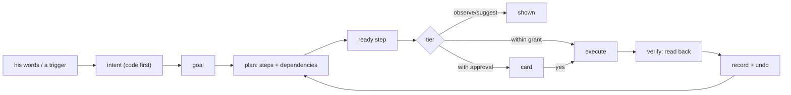
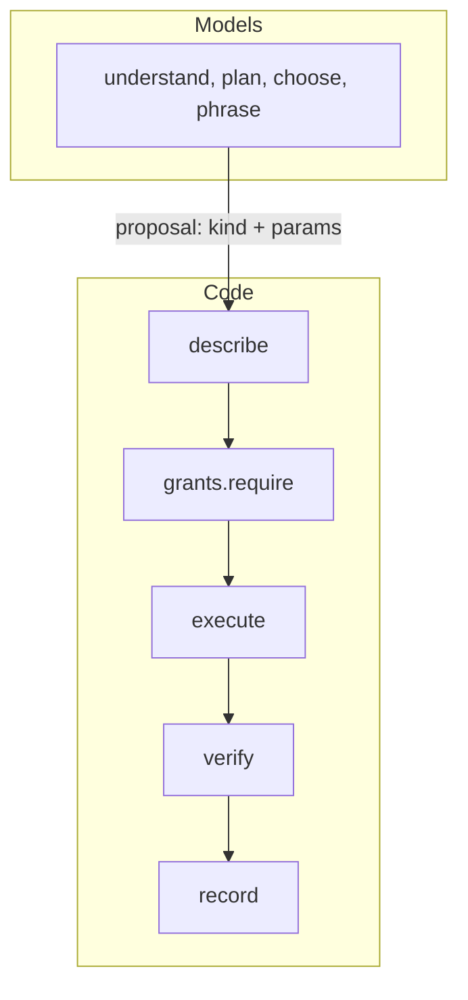
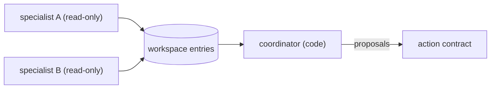
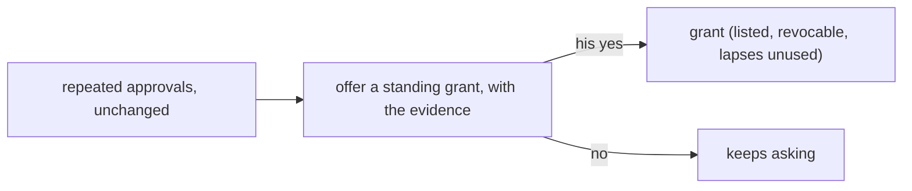
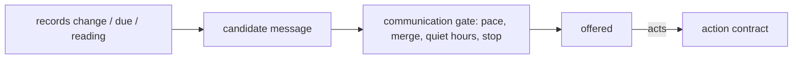
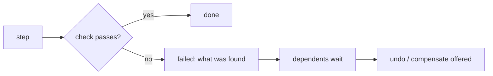

# MIA OS: autonomy architecture diagrams (Prompt 08 §24)

*Claude (Opus), 2026-11-17. Mermaid.*

## 1. From intent to verified change

## 2. The execution boundary

## 3. Agents and the coordinator

## 4. Autonomy growth

## 5. Proactive path

## 6. Failure and rollback

