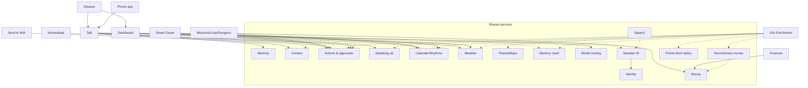

# MIA OS: capability dependency map (Prompt 02 §6)

*Claude, 2026-11-15. Solid lines are dependencies that exist today; dashed
lines are new (committed or proposed).*

## What each major capability needs (Prompt 02 §6, items 1–10)

| Capability | Used by | Provided by | Consumes | Produces | State | AI | Where | Permissions | If unavailable |
|---|---|---|---|---|---|---|---|---|---|
| Calendar | LEP, Closet, missions, Dashboard | calendar manager | events, rhythms | free time, agenda | yes | no | local | read own; household shared | apps show "no calendar" and keep working |
| Money and discretionary money | LEP, Dungeon, Finances | finance manager (new calculation) | balances, bills, goals | spendable amount, cost fit | yes | no | local (Plaid sync) | read-only bank; never pays | LEP suggests free things only |
| Weather | Dashboard, LEP, Closet | `core/weather.py` | town | forecast | cached | no | online fetch | network | last forecast, marked stale; Closet asks |
| Speaker ID | Talk, glasses, Pi | new | audio, voiceprints | person id and confidence | voiceprints | yes (model, local) | on device | microphone; consent | MIA asks who's speaking; no approvals by voice |
| Discovery (LEP) | LEP, Dashboard | new adapters | sources, radius, interests | candidate events | yes | parse only | online | fetch policy | saved catalogue only |
| Actions | everything | `core/actions.py` | proposals | changes, undo | yes | no | local | per action | nothing changes |
| Memory Vault | LEP journal, Closet | memory vault | photos | references | yes | captions | phone ↔ PC | gallery permission | text-only records |
