# MIA OS: core architecture diagrams (Prompt 05, deliverable 13)

*Claude (Fable), 2026-11-16. Planning only. The twelve diagrams Prompt 05 asks for, in Mermaid. In every diagram:*

- *grey boxes are **existing Linux** components, used as they are;*
- *blue boxes are **existing MIA** components;*
- *green boxes are **new or modified MIA** components this architecture proposes;*
- *dashed boxes are **optional or external**.*

*The text of each is in the document named under it. Nothing drawn here is built unless it is blue or grey. The
diagrams' syntax was checked by reading, not yet by a renderer (2026-11-16).*

## 1. MIA OS, high level

Linux underneath, untouched; MIA as services and a session on top; applications and devices around.

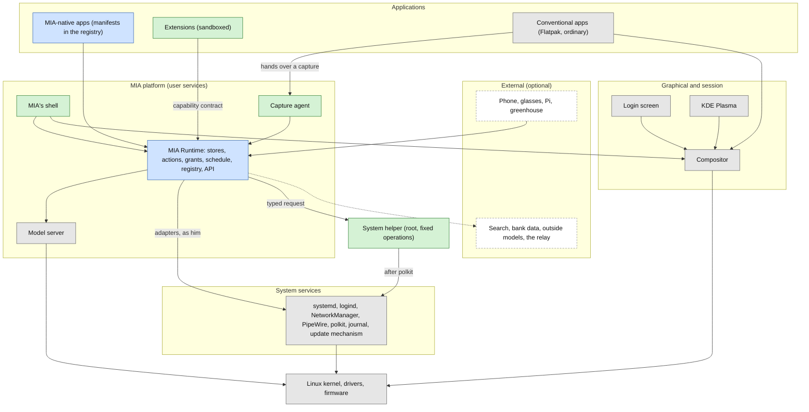

*Core architecture §2 and §3.*

## 2. Linux foundation

Everything in this diagram is the distribution's. MIA adds only files to the image.

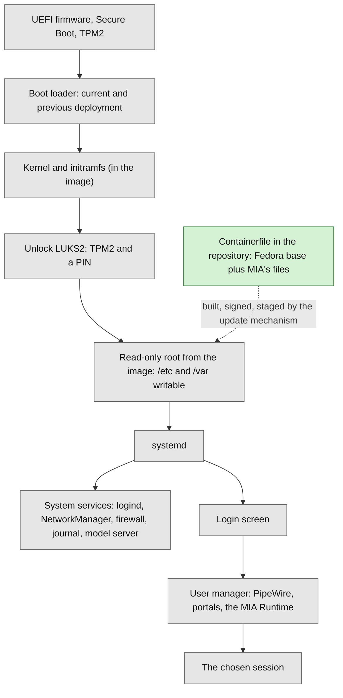

*Linux foundation §3.*

## 3. MIA platform integration

How MIA's services meet Linux: adapters for reading and ordinary use, the helper for system changes.

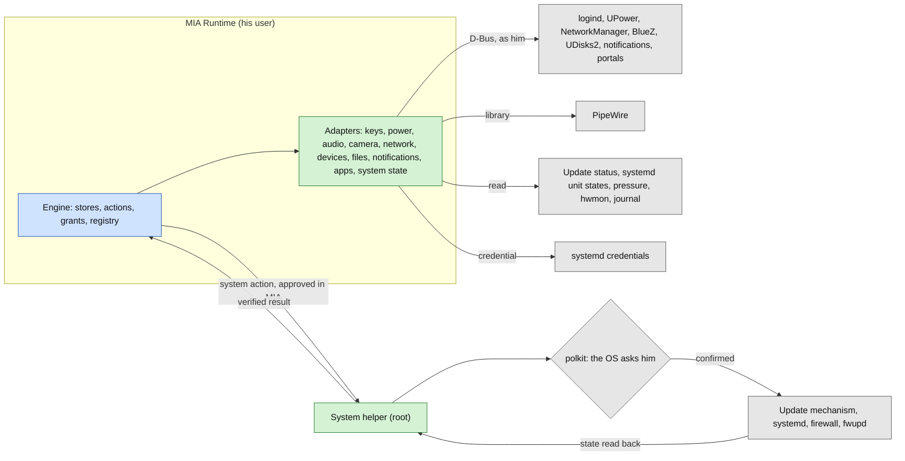

*Core architecture §4; privilege boundaries §3.*

## 4. Service dependencies, at start and while running

Solid arrows are "requires"; dotted are "wants" (works without). No solid arrow points from Linux to MIA.

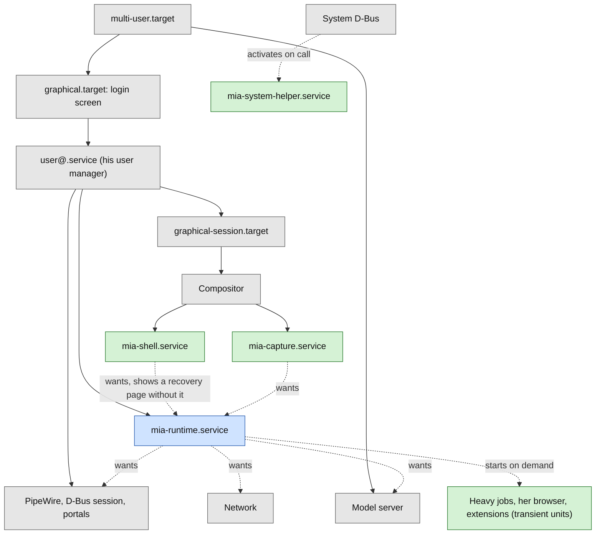

*System service architecture §2 and §3.*

## 5. Graphical session

Two entries at login, one running at a time, sharing the person's services. The compositor for MIA's session is
provisional (proof of concept 3).

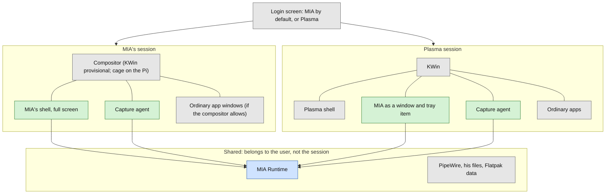

*Graphical and session architecture §3 and §4.*

## 6. Applications and the platform

Prompt 03's framework on OS-level services: three kinds of application, three different doors.

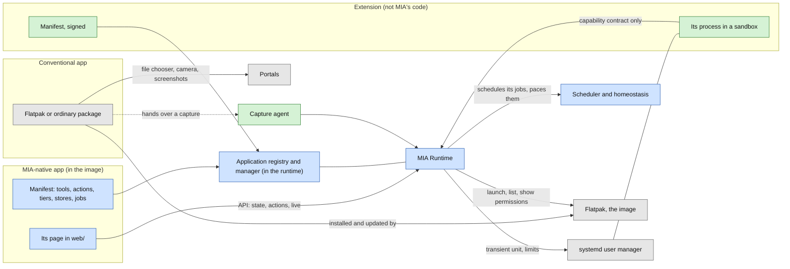

*System service architecture §2.5; storage §4.*

## 7. IPC and communication

One mechanism per kind of conversation.

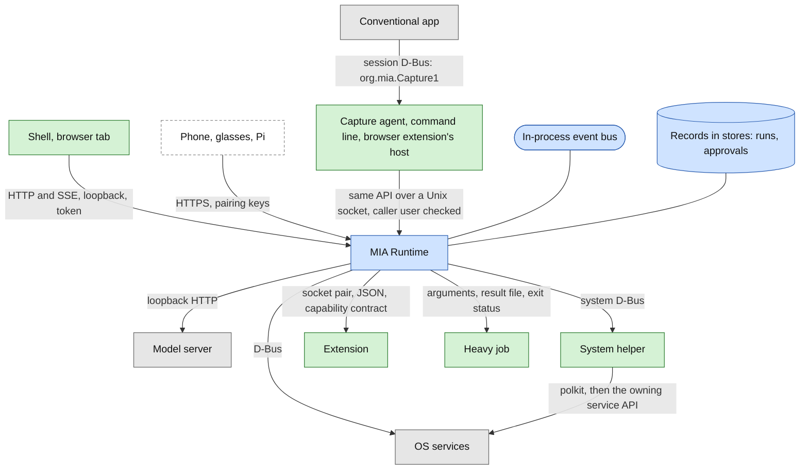

*IPC and communication architecture §1.*

## 8. Storage and filesystem

Separate lifetimes on separate subvolumes of one encrypted volume.

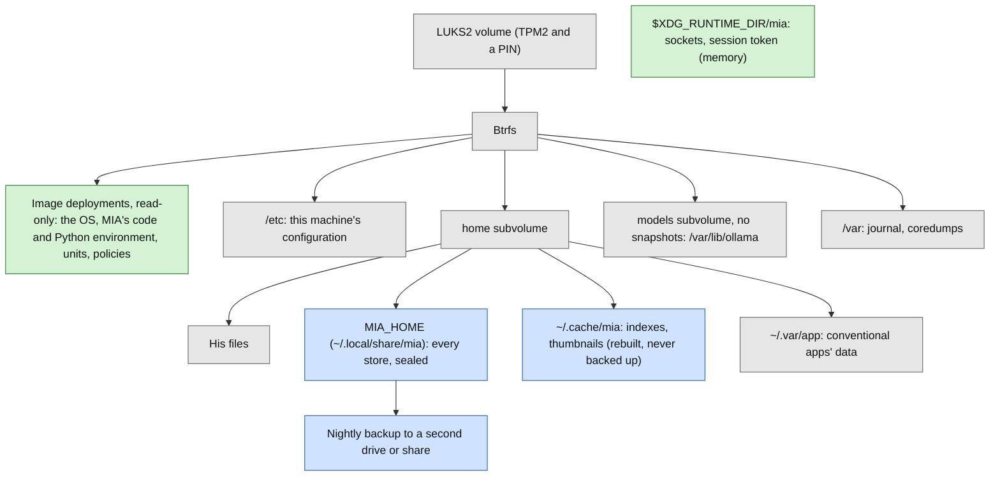

*Storage and filesystem architecture §2.*

## 9. Hardware abstraction

MIA's code begins at the adapter; everything left of it is Linux.

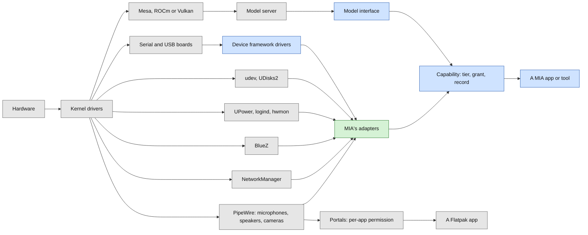

*Hardware abstraction architecture §1 to §3.*

## 10. Privilege and trust boundaries

Each box can reach the next only through the labelled door. Root appears once.

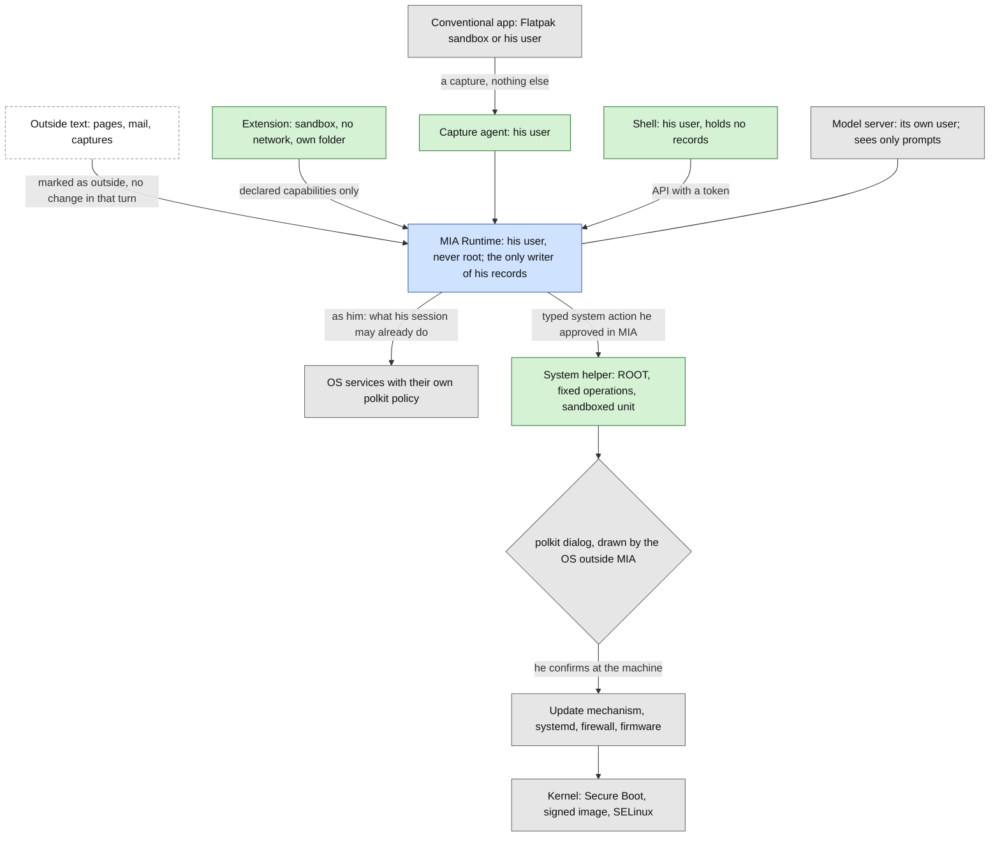

*System privilege boundaries §1 to §3.*

## 11. Resource management

Slices decide who wins; homeostasis decides whether MIA's own background work runs at all.

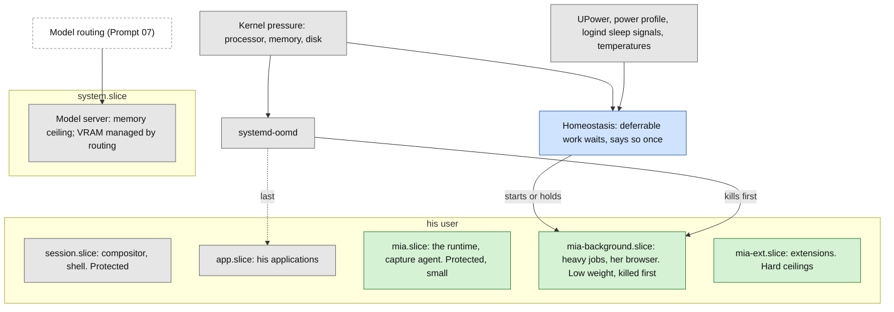

*System resource management §1 and §2.*

## 12. Build versus reuse

Almost everything is grey. What MIA writes is on the right.

```mermaid
flowchart LR
  subgraph USE["Used or configured as it is"]
    a["Kernel, firmware, boot"]:::linux
    b["systemd, logind, journal, oomd"]:::linux
    c["Update mechanism (bootc)"]:::linux
    d["KDE Plasma, compositor, login screen, portals"]:::linux
    e["NetworkManager, firewalld, PipeWire, BlueZ, UPower, UDisks2, fwupd"]:::linux
    f["Flatpak, bubblewrap, polkit, SELinux, LUKS"]:::linux
    g["Model server"]:::linux
  end
  subgraph HAVE["Existing MIA"]
    h["Runtime, stores, actions, grants, registry, scheduler, homeostasis, gate, API, web front end, sealing"]:::mia
  end
  subgraph WRITE["New or modified MIA"]
    i["The image definition, units, slices, session entry, polkit actions, udev rules"]:::new
    j["Adapters' Linux halves"]:::new
    k["Shell host and recovery page"]:::new
    l["Capture agent"]:::new
    m["System helper"]:::new
    n["Runtime: readiness, watchdog, journal logging, socket, workers"]:::new
  end
  USE --> HAVE
  HAVE --> WRITE

  classDef linux fill:#e6e6e6,stroke:#666,color:#111
  classDef mia fill:#cfe3ff,stroke:#2a5db0,color:#111
  classDef new fill:#d5f2d5,stroke:#2e7d32,color:#111
```

*Build versus reuse §2 and §3.*
