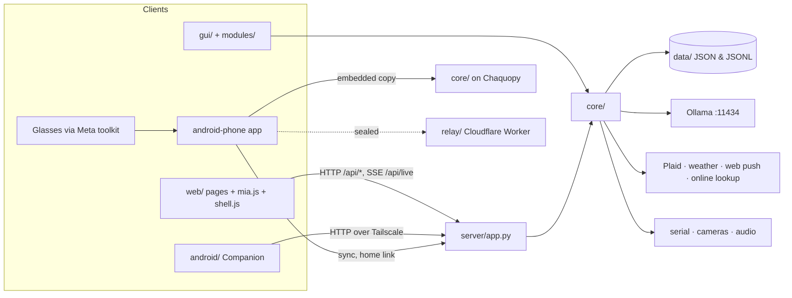
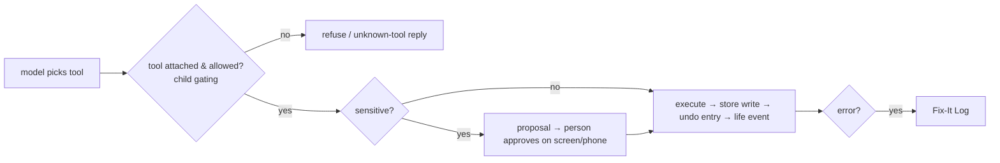

# MIA OS: dependency and data-flow map (Prompt 01 §15)

*Claude, 2026-11-15. These diagrams describe what exists at
`c0a71610`, traced from code. They aren't a design.*

## 1. Component dependencies



## 2. Conversation workflow

```mermaid
sequenceDiagram
  participant U as Person
  participant UI as Talk (web/Qt/phone)
  participant S as server/app.py
  participant T as assistant_turn.run_assistant_turn
  participant M as matching_actions + presence
  participant L as llm_manager (Ollama / llama-server)
  participant A as AssistantAction / core.actions
  U->>UI: says or types
  UI->>S: POST (Bearer token)
  S->>T: turn(context = person's view)
  T->>T: safety_floor, pre_turn (talk_it_out)
  T->>M: attach tools by domain/phrases; assemble facts
  M->>L: system message + facts + tools
  L-->>T: reply or tool call
  T->>A: execute tool (code-checked); sensitive → proposal needing approval
  A-->>T: result / ActionError
  T-->>S: reply (+ offer: life note / did-it)
  S-->>UI: response; /api/live bumps
```

- **Entry point:** a Talk request, with its token checked.
- **Security:** a token for each person; tools attached by code; sensitive actions only through an approval.
- **Failure:**
  - an unknown or broken tool gives a human reply and goes to the Fix-It Log;
  - a missing model gives the unavailable reply.
- **Exit:** the reply, plus a write to the stores and the life events.

## 3. Memory workflow

1. After a turn, the LLM extracts candidate facts (`assistant_chat.build_memory_extraction_prompt`).
2. `user_memory_manager` stores them as JSON. The person can review or delete them in the Memories app.
3. Later turns pull matching memories into the facts, by keyword.
4. Corrections are edits through the screen (`corrections.screen_edit`).
5. Nothing is embedded.

## 4. Voice workflow

- **PC:**
  1. Microphone through sounddevice.
  2. Vosk speech to text.
  3. A turn.
  4. Kokoro or Piper text to speech.
  5. Speaker through sounddevice.
- **Phone:** Android's recogniser, then the in-app engine, then Android's TTS. Heavy speech can go to the PC (`heavy_jobs`).
- **Pi:** a GPIO push-to-talk pin, then `core/voice_loop.py`.
- **Failure:** a missing voice model degrades to text. Not run here.

## 5. Tool execution



## 6. Device communication

1. **Sign-in:** the phone signs in to the PC's server and gets a Bearer token.
2. **Link:** the home link (`/api/home_pc/connect`) works on the same Wi-Fi or through `tailscale serve`.
3. **Sync:** `core/sync.py` runs whenever the PC is reachable, started by the phone.
4. **Disconnect:** the phone falls back to its own model and stores, and merges at the next sync.
5. **Glasses:** they reach MIA only through the phone. Display cards go through the sealed relay.

## 7. App workflow

**Web page:**
1. `MIAShell.start()` checks the session.
2. The page loads its data, `MIA.x()` → `/api/x`, assembled in core.
3. A change goes through `MIAShell.act` → `/api/actions`.
4. The page reads again on `/api/live`.

**Qt module:**
1. It is discovered at boot; its `__init__` stays cheap.
2. `on_load` runs on first open.
3. `get_widget()` shows it.
4. State lives in the stores.
