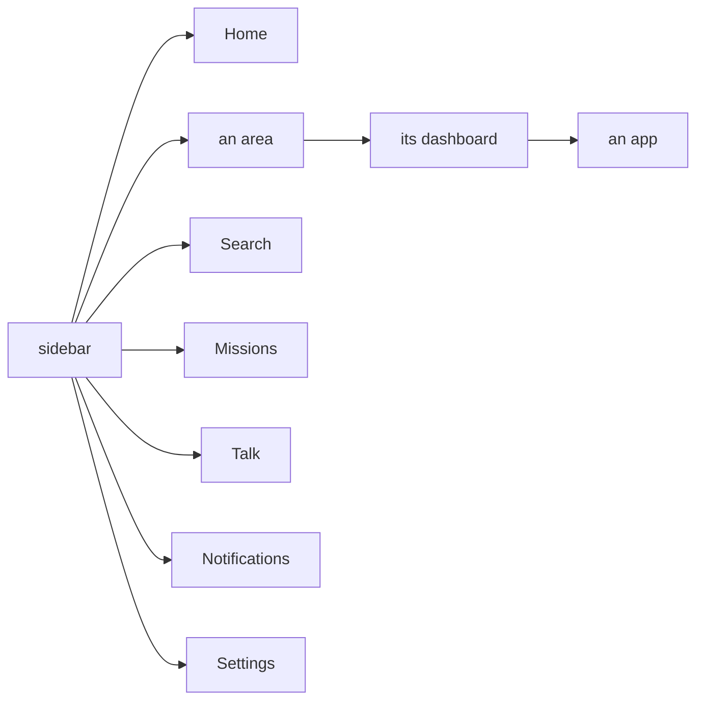
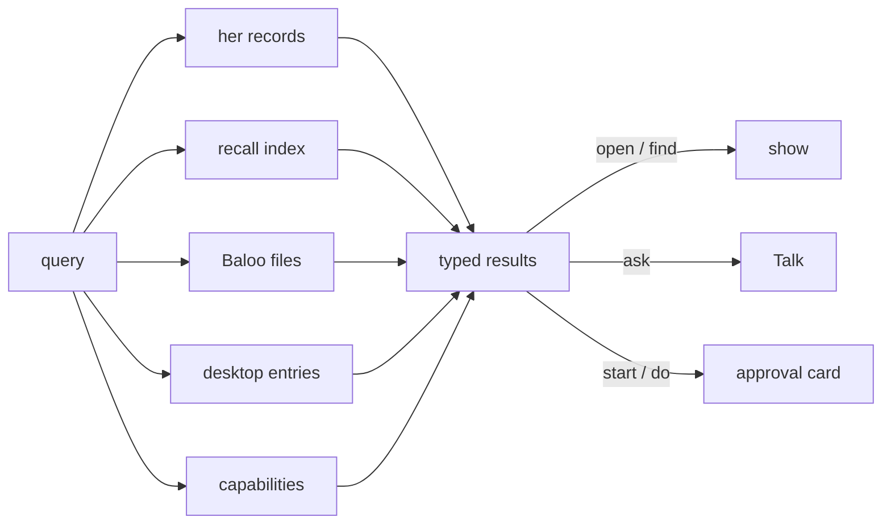
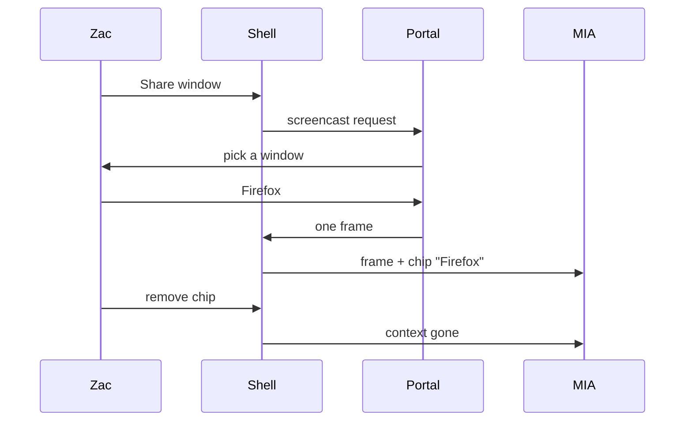
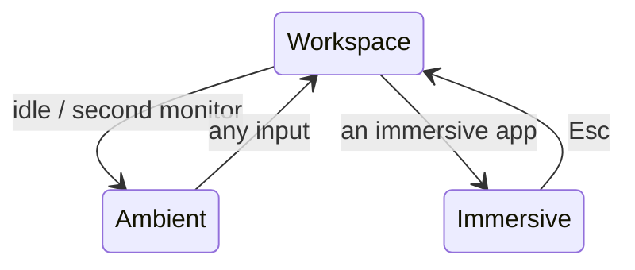
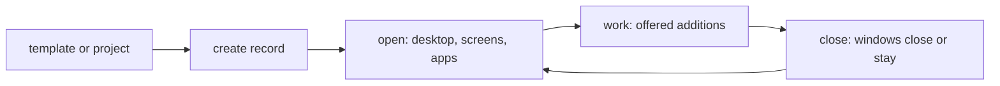
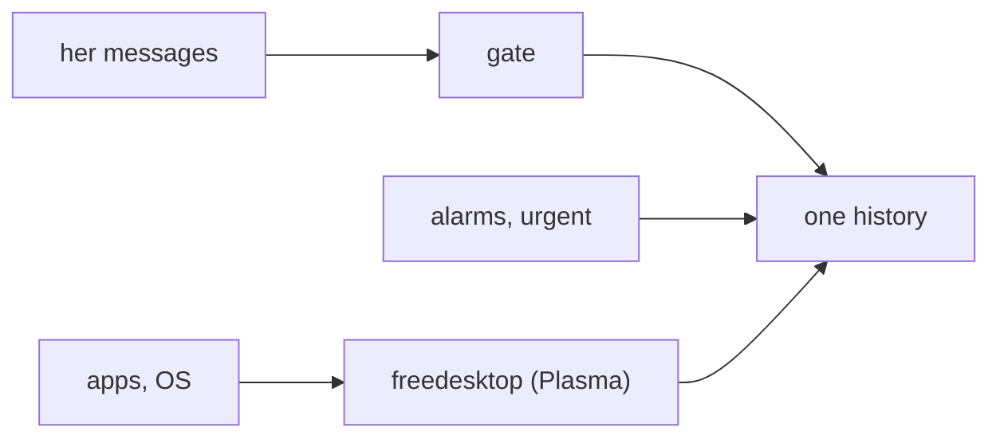
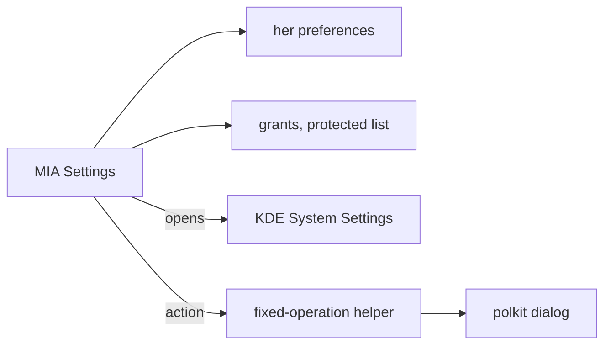
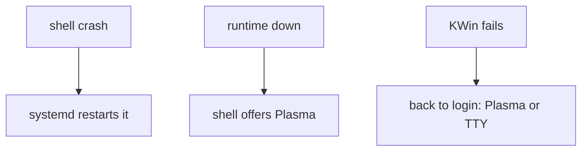

# MIA OS: desktop diagrams and wireframes (Prompt 10 §23)

*Claude (Opus), 2026-11-17. Mermaid and text wireframes; structure, not final visuals.*

## 1. The whole desktop

```mermaid
flowchart TB
  SDDM["SDDM login"] -->|MIA (default)| KW["KWin (MIA session)"]
  SDDM -->|Plasma| PL["KDE Plasma"]
  KW --> SHELL["MIA shell: Qt WebEngine window (web/)"]
  KW --> APPS["Linux apps (Flatpak)"]
  SHELL --> RT["MIA runtime: stores, actions, gate, search"]
  RT --> INT["intelligence (P07)"] & AUT["autonomy (P08)"] & SELF["self-awareness (P09)"]
  SHELL -.portals.-> PORT["xdg-desktop-portal-kde"]
  SHELL -.D-Bus.-> NOTIF["notifications, Baloo, KWin scripts"]
```
The shell is one client of KWin; Linux apps are others. Everything she does reaches the OS through portals and D-Bus.

## 2. Navigation



## 3. Search



## 4. Context sharing



## 5. Modes



## 6. Workspace lifecycle



## 7. Notifications



## 8. Settings boundaries



## 9. Failure and fallback



Further: the launcher, windows, missions, files, voice, accessibility, household and app integration are the tables
in their documents; each is a single flow through the shell, the runtime and the OS as above.

## 10. Wireframes

**Workspace mode, 4K at 150 % (2560 logical px):**
```
+--------+----------------------------------------------+---------------+
| MIA    | Home                         9:41  ☀ 31°  ● 2 |  Talk         |
| Home   | +--------------------+ +--------------------+ |  [Garage] x   |
| Garage | | Today              | | Due                | |               |
| ...    | +--------------------+ +--------------------+ |  > ...        |
|        | +--------------------+ +--------------------+ |               |
| ⌘K     | | Missions           | | MIA's activity     | |               |
+--------+----------------------------------------------+---------------+
| [Konsole] [Firefox]                                 Garage ▾  ⏹ stop  |
+-----------------------------------------------------------------------+
```

**Ambient, second monitor:**
```
+-----------------------------------------------+
|  9:41                Tuesday 17 November       |
|  ☀ 31°   next: dentist 2:30   music: ▶ ...     |
|  due: oil change · seed order                  |
|  ● MIA: Night School finished, 1 change in     |
+-----------------------------------------------+
```

**Immersive:**
```
+-----------------------------------------------+
|                Living World                    |
|                                     [Esc] back |
+-----------------------------------------------+
```

**Narrow (1280×720):**
```
+--+------------------------------------+
|⌂ | Garage                  9:41  ● 1  |
|🚗| [Vehicles] [Maintenance]           |
|$ | [Projects]                         |
|⌘ |              (Talk slides over)    |
+--+------------------------------------+
```
