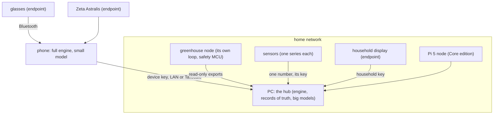
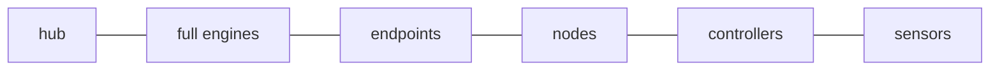
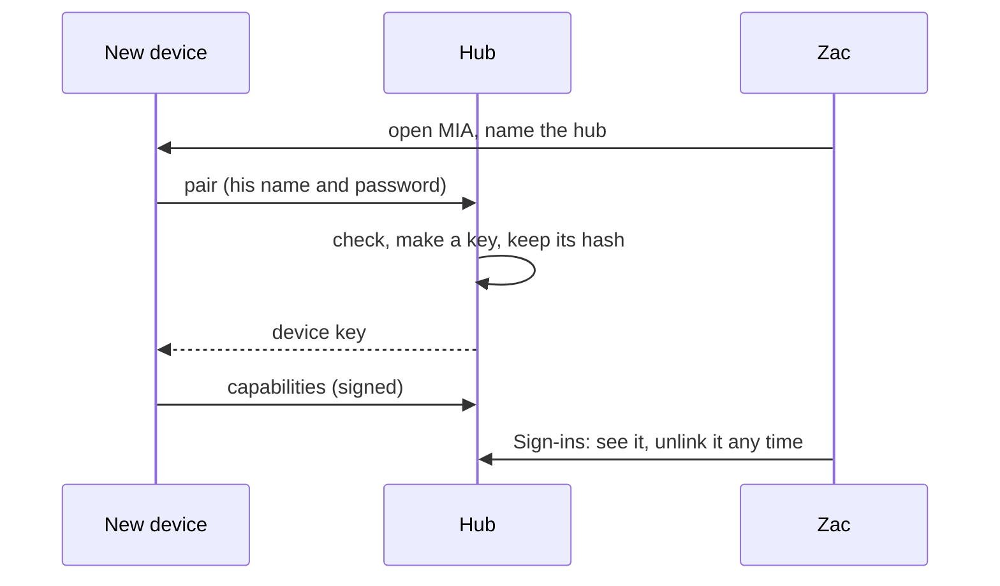
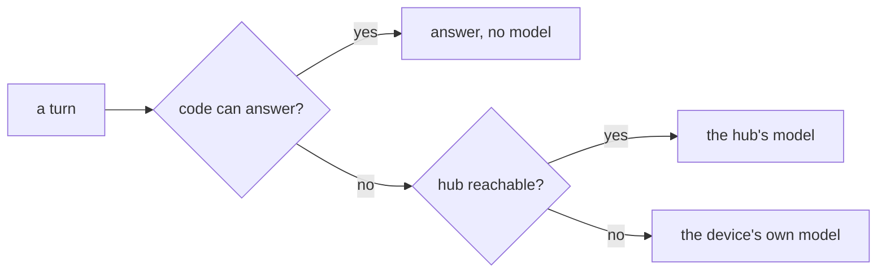
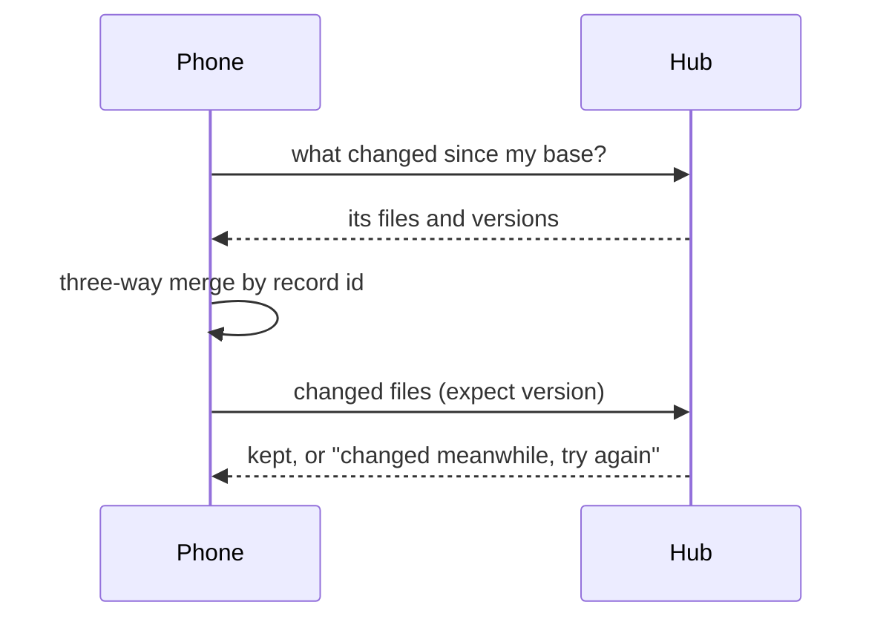
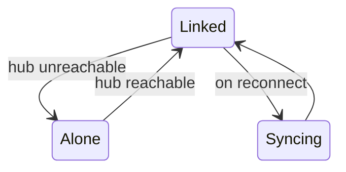
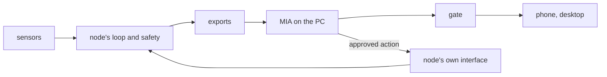
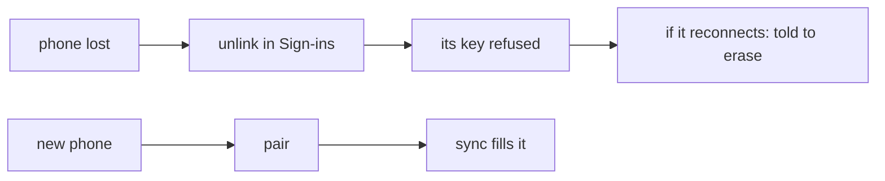

# MIA OS: distributed diagrams (Prompt 12 §24)

*Claude (Opus), 2026-11-18. Mermaid.*

## 1. The whole

## 2. Device classes

## 3. Pairing

## 4. Thinking

## 5. Sync

## 6. Offline and reconnection

## 7. Greenhouse

## 8. A lost device

The remaining views (agents, sessions, observability, versions) follow diagram 1's paths; each is a table in its
document.
