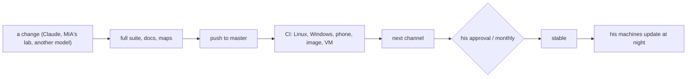
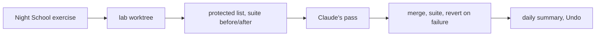
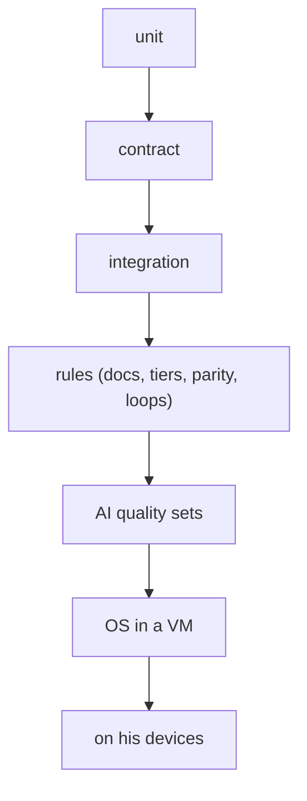
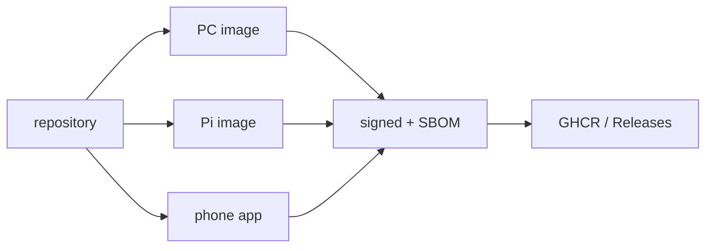
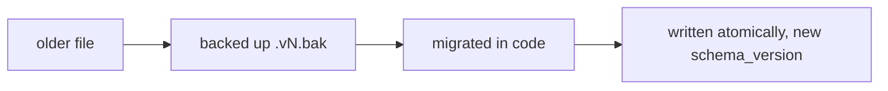

# MIA OS: engineering diagrams (Prompt 15)

*Claude (Opus), 2026-11-18. Mermaid.*

## 1. From a change to his machines

## 2. Her own change

## 3. Tests in layers

## 4. Release artifacts

## 5. A store migration

