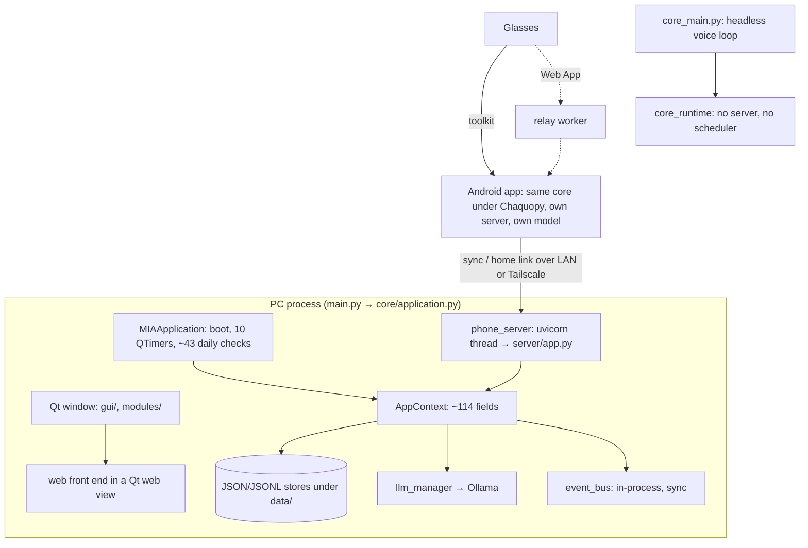

# MIA OS: existing system audit (Prompt 01)

*Claude, 2026-11-15. Checked at commit `c0a71610` on `master`, in a
Linux cloud checkout of `github.com/TheKingCS/MIA` (`/home/user/MIA`).
The PC checkout (`C:\Users\zacrh\MIA`) wasn't reachable from this
session, so nothing here is verified on the PC itself; anything that
depends on it is marked as such. This supersedes
`preliminary/MIA_CURRENT_ARCHITECTURE_AUDIT.md` (2026-11-13), which is
kept for history and was wrong in one place (section 9).*

**Status words** (from the Prompt 01 directive):
- **Verified**: seen in code and run (a test or a command) in this audit.
- **Implemented**: in code, not run here.
- **Partial**: some of the feature exists.
- **Experimental**: a prototype or not settled.
- **Documented only**: described in docs, no code found.
- **Planned**: intended for later.
- **Unverified**: not enough evidence either way.
- **Deprecated**: no longer maintained.
- **Broken**: a failure was reproduced.

Companion reports:
- [Technology stack](MIA_OS_TECHNOLOGY_STACK.md)
- [Feature inventory](MIA_OS_FEATURE_INVENTORY.md)
- [Data architecture](MIA_OS_DATA_ARCHITECTURE_AUDIT.md)
- [Security](MIA_OS_EXISTING_SECURITY_ASSESSMENT.md)
- [Testing](MIA_OS_TESTING_AND_QUALITY_AUDIT.md)
- [Risks](MIA_OS_TECHNICAL_DEBT_AND_RISK_REGISTER.md)
- [Data flows](MIA_OS_DEPENDENCY_AND_DATA_FLOW_MAP.md)
- [Migration readiness](MIA_OS_MIGRATION_READINESS.md)

## 1. Repository structure

Tracked files per directory. Line counts cover `.py .js .kt .ts .html
.css .ps1 .sh` only. Measured with `git ls-files` on 2026-11-15.

| Directory | Files | Lines | Purpose | Depends on | State |
|---|---|---|---|---|---|
| `core/` | 521 | 150,679 | The engine: stores, assistant, actions, sync, security, every domain's logic | Python stdlib, cryptography, fastapi (server only), optional numpy/vosk/piper | Active, foundational |
| `server/` | 8 | 5,252 | FastAPI app (`server/app.py`, 265 routes) | `core/` | Active |
| `web/` | 293 | 34,996 | The one web front end: 102 pages, `mia.js`, `shell.js`, tokens/themes | the API only | Active |
| `gui/` | 123 | 21,950 | Qt (PySide6) desktop shell, the "classic view" | `core/` | Active, secondary since DEC-0124 |
| `modules/` | 93 | 22,670 | 35 Qt desktop modules, found by `core/module_manager.py` | `core/` via `ModuleBase` | Active, secondary |
| `android-phone/` | 32 | 3,461 | The current Android app: Kotlin + the engine under Chaquopy | `core/`, `web/`, Meta Wearables toolkit | Active |
| `android/` | 23 | (Kotlin) | The older "MIA Companion" app, a client of the PC server; still built by `android.yml` | the server API | Active, overlaps with `android-phone/` (see the risk register) |
| `relay/` | 6 | 69 | Cloudflare Worker relaying sealed payloads for the glasses (DEC-0062) | wrangler | Active, small |
| `homestead/` | 117 | 23,317 | Greenhouse and aquaponics subproject: its own `core`, firmware, drivers, scenarios (DEC-0145) | own `requirements.txt` | Active, self-contained |
| `tools/` | 39 | 4,031 | CLIs: atlas, parity, docs, data key, cloud tests, page check | `core/` | Active |
| `tests/` | 479 | 79,855 | pytest suite (5,646 `def test` functions) | everything | Active |
| `deploy/` | 6 | 494 | Pi kiosk systemd user service, Windows helpers | none | Active (Pi path unverified on hardware) |
| `work/` | 289 | (data) | Development platform ledger: agents, council, 224 knowledge entries, loop coverage, baselines | read by `core/` | Active |
| `docs/` | 470 | (prose) | 157 decisions, specs, plans, hub files, generated atlas/map/parity | none | Active, partly stale (risk R-12) |
| `config/` | 2 | none | `default_config.json` (versioned); the person's `config.json` is gitignored | none | Active |
| root | — | — | `main.py` (Qt entry), `core_main.py` (headless entry), Windows installers and stay-up scripts | — | Active |

Runtime-only folders at the root (`data/`, `logs/`, `financial_snapshots/`, `trip_photos/`, `voice_models/`, ...) are gitignored apart from a `.gitkeep` or seed file each.

**Classification.** MIA is a **modular monolith with satellite apps**. One Python process holds the engine, the API server, the scheduler and (on the PC) the Qt window. The phone runs a second copy of the same engine inside its own app. The relay and the homestead firmware are separate programs. The modules aren't separate services: they are packages loaded in-process. Evidence: `core/application.py` (the PC process), `core/phone_server.py` (the API server on a thread) and `android-phone/` (the engine under Chaquopy).

## 2. History (Prompt 01 §13)

- Commits:
  - 1,286 on `master`, from 2026-08-26 to 2026-11-12.
  - Authors: "Claude" 1,103; "Zac" and "TheKingCS" 181 together; "MIA Lab" 2.
- Branches:
  - `master`.
  - `origin/claude/design-standards` (merged).
  - The working tree was clean apart from this planning work.
- Decisions: 157 `### DEC-` entries in `docs/DECISIONS.md`, from DEC-0001 to DEC-0158. DEC-0154 to DEC-0158 are the first MIA OS proposals, still PROPOSED.
- Direction changes that matter for MIA OS:
  - DEC-0012/0017/0124: the web becomes all of MIA, and the desktop opens it.
  - DEC-0015: the device order is PC, phone, glasses, then the Pi.
  - DEC-0022: the phone runs its own engine and links to the PC.
  - DEC-0062: the glasses go through a sealed relay.
  - DEC-0115 and DEC-0119: who MIA is for, now one owner.
  - DEC-0126: encryption at rest.
  - DEC-0145: the homestead merge.
  - DEC-0153: eight destinations.
- **The current code follows the latest direction.** The web-first desktop, the eight destinations and the phone engine are all present in code.

## 3. MIA Core (Prompt 01 §6)

Answers to §6's questions:

1. **Central logic** lives in `core/`. Everything else is a client or a host.
2. **Persistent identity**:
   - the profiles (`core/profile_manager.py`);
   - the person's stores under `data/profiles/<id>/`;
   - self-knowledge built from records (`core/self_knowledge.py`);
   - standing directions and the answer-style settings.

   None of it lives in a model.
3. **Essential services**:
   - config;
   - profiles;
   - stores with atomic writes and the store lock;
   - the action contract (`core/actions.py`);
   - the API server.

   The LLM is not essential: the screens work without it, and the turn code has a "model unavailable" path.
4. **Services that work alone**: sync, backup, the communication gate, the safety floor, the life events and the whole web front end. Each runs without the model.
5. **Capabilities**:
   - Assistant tools are `AssistantAction` records in `core/assistant_actions.py`, about 378 of them. They are matched by domain and trigger phrases (`core/matching_actions.py`).
   - Screen changes go through `core/actions.py`.
   - `core/capabilities.py` builds the list from code.
   - Qt modules are discovered by `pkgutil`.
6. **Startup and shutdown** are in `MIAApplication`:
   - boot steps are chained with `QTimer.singleShot`;
   - background work runs on 10 `QTimer`s.

   **Verified by inspection:** these are the only scheduler. Headless `core_runtime` has none.
7. **Shared state** is `AppContext`, an explicit dataclass with no globals by convention. Stores are files, and `core/live.py` counts writes.
8. **Two things tie the core to the current interface:**
   - the scheduler and the server hosting both live in the Qt process;
   - some boot logic is Qt-chained.

   The core modules themselves don't import Qt (`core_main.py` runs without PySide6).
9. **To extract for an OS:** the scheduler, the server host and the store-lock owner, put into a runtime process. This is the main finding, as on 2026-11-13.

**Failure behaviour:**
- A broken module is logged and skipped (`core/module_manager.py`).
- A tool that raises returns "Something on my side broke" and is recorded in the Fix-It Log (`core/failure_log.py`).
- An unreachable model gives a human "model unavailable" reply.

**Unverified:** how the PC behaves when the API server's thread dies. Nothing found restarts it.

## 4. AI infrastructure (Prompt 01 §8)

| Area | Evidence | Status |
|---|---|---|
| Local models | `OllamaBackend` and `OpenAIBackend` (llama-server) in `core/llm_manager.py`; the PC uses qwen2.5:14b per docs | Implemented; PC use documented, not verified here (no GPU or Ollama in this session) |
| Model facts | `core/model_registry.py` asks the runtime (`/api/show`), never a name list | Implemented, tested |
| Three levels | phone model → PC model over `core/home_link.py` → online lookup when asked (DEC-0022, DEC-0053) | Implemented |
| Cloud models | Only in the owner-only development council (`core/council*.py`) and the homestead's opt-in Anthropic assistant; the everyday assistant doesn't call cloud LLMs | Implemented (council) |
| Tool calling | Code picks the tools (domain match, trigger phrases); the model may choose among attached tools; facts are assembled in code (DEC-0004) | Verified by tests |
| Context | `core/presence.py` (every turn), `core/context_assembler.py`, conversation modes | Implemented, tested |
| Memory | `core/user_memory_manager.py`: facts pulled out by the LLM, stored as JSON, reviewable and deletable; **keyword matching, no embeddings or vector store** | Implemented |
| Retrieval | keyword and recency in stores, the search providers, `core/dev_knowledge.py` for development | Implemented |
| Speech | `VoskBackend` (speech to text), `PiperBackend`, `KokoroBackend` (text to speech) in `core/voice_manager.py`; Android's recogniser and voice on the phone | Implemented; PC audio not run here |
| Vision | glasses camera (`GlassesCamera.kt`), OCR (`core/ocr.py`), photo captions (`core/vault_captions.py`) | Implemented, hardware not run here |
| Grounding | the model phrases and code decides (DEC-0004); `self_knowledge`, `service_map`, `capabilities` answer "what can you do" from code; the Fix-It Log catches dead ends | Implemented, tested |
| Cancellation | streamed turns exist; no general cancel-a-running-inference control found | Partial |
| Resource management | `core/heavy_jobs.py` sends heavy work to the PC; no GPU memory accounting found | Partial |

**On the reported quality problems** (repetition, unsupported claims, wrong self-knowledge):
- Code answers capability questions.
- `tests/live_model_check.py` holds person-like cases with a dead-end pattern.
- Whether the real model still repeats or invents things **can't be verified without the PC's model**. That check stays pending: "run PERSON_CASES on the 14b".

The turn path is drawn in [the data-flow map](MIA_OS_DEPENDENCY_AND_DATA_FLOW_MAP.md).

## 5. Interfaces and devices (Prompt 01 §9)

| Device | How it reaches the core | Status |
|---|---|---|
| PC web front end | Qt web view on `http://127.0.0.1:8765/web/` (port in `core/phone_server.py`, default 8765) | Implemented; daily use per hub docs |
| PC classic view | Qt screens in-process | Implemented |
| Phone (`android-phone/`) | its own engine and server inside the app; WebView; sync and home link to the PC over LAN or Tailscale | Implemented; published test builds by CI |
| Phone (`android/`, Companion) | thin client of the PC server over Tailscale | Implemented; overlaps with the above |
| Glasses (Meta Ray-Ban Display) | Meta Wearables toolkit 1.0.1 (`mwdat-core`, `-display`, `-camera`) through the phone; Web App through `relay/` | Implemented, gated by Meta's toolkit; not run here |
| Neural Band, watches | none found | Planned |
| Pi | `core_main.py` and `deploy/install_kiosk.sh` | Implemented; AI HAT+ 2 path "unconfirmed" (`docs/KNOWN_ISSUES.md`) |
| Greenhouse nodes | `homestead/firmware`, `core/greenhouse_link.py`, `/api/sensors/reading` | Partial (simulation-first) |

**Networking:**
- The server listens on 127.0.0.1.
- Away from home, the phone reaches it through `tailscale serve`.
- Live updates come over `/api/live` (server-sent events).
- No mDNS or device discovery protocol was found.
- Pairing is sign-in plus a home-link token.

## 6. Data, security and testing

These have their own reports:
- [data architecture](MIA_OS_DATA_ARCHITECTURE_AUDIT.md);
- [security assessment](MIA_OS_EXISTING_SECURITY_ASSESSMENT.md);
- [testing and quality](MIA_OS_TESTING_AND_QUALITY_AUDIT.md).

## 7. Most important findings

1. **The intelligence is already independent of the OS** (headless and Android prove it). The runtime isn't: it lives in the PC's Qt process.
2. **Sealing data at rest only works on Windows.** `core/at_rest.py` says so: "Where DPAPI isn't (Linux, the phone until its Keystore step) nothing is sealed." No Keystore code was found in `android-phone/`. On Linux today, MIA's stores would be plain files. The 2026-11-13 first-pass audit wrongly said the phone used the Keystore.
3. **Memory is keyword-based**, with no embeddings. That is fine for now, but it is a decision Prompt 07 has to make.
4. **There are two Android apps** (`android/` and `android-phone/`), both built in CI.
5. **One process, one writer.** The store lock already enforces one writer per data folder, which suits a runtime service.
6. **The test suite is large, and the test documentation is kept honest by tests.** Results are in the testing report.

## 8. What this audit could not verify

- Anything on the PC:
  - GPU and Ollama;
  - Kokoro audio;
  - DPAPI sealing;
  - uncommitted edits left from the deleted PC session.
- The phone and glasses on real hardware.
- The Pi with the AI HAT+ 2.
- The greenhouse nodes.
- The live model's answer quality.

Each needs a PC session, the phone, or the hardware itself. They are listed in `MIA_OS_OPEN_QUESTIONS.md`.
