# MIA OS: final architecture diagrams (Prompt 17 §16)

*Claude (Opus), 2026-11-18. Version 1.0. Mermaid. One set of names throughout: **the OS** (Fedora Kinoite with
systemd, KWin, Plasma Login Manager), **the runtime** (MIA's engine as a user service), **the shell** (her front end
in a WebEngine window), **the helper** (fixed system operations), **stores** (his data), **devices** (phone, glasses,
Pi, laptop).*

## 1. The whole system

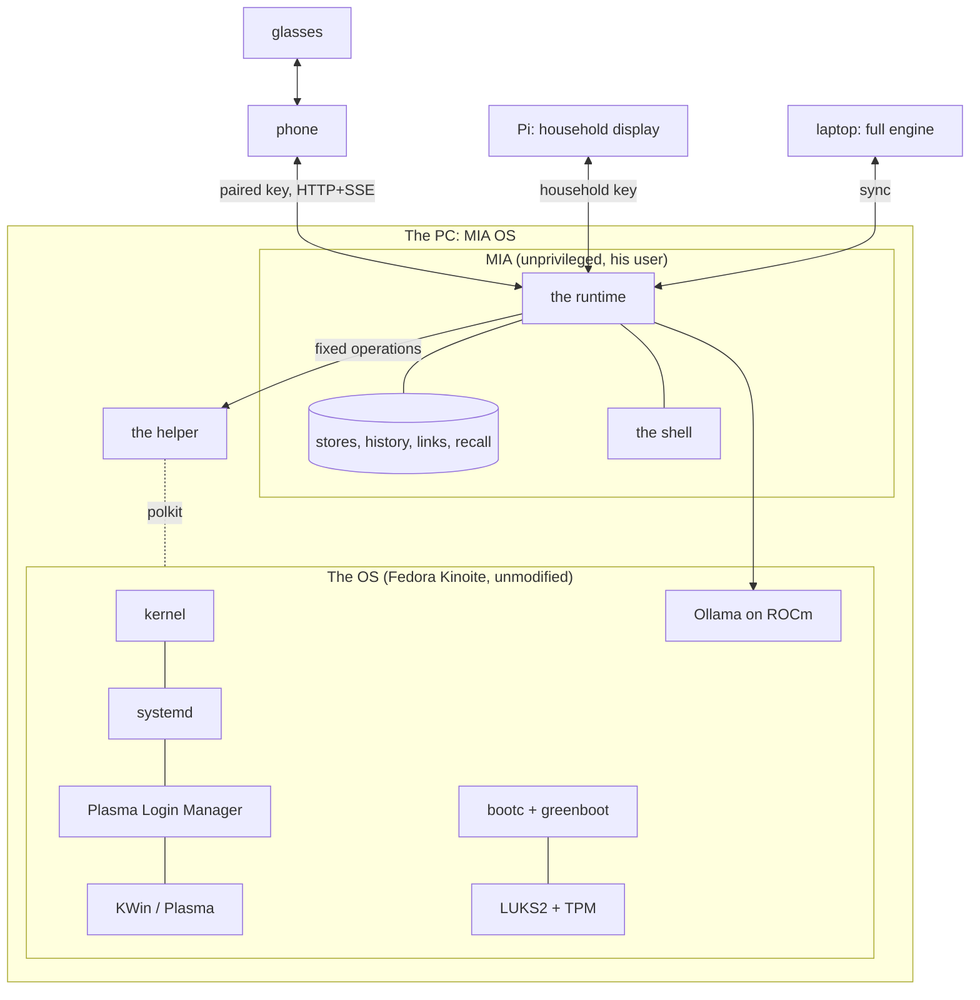

## 2. Linux and MIA boundaries

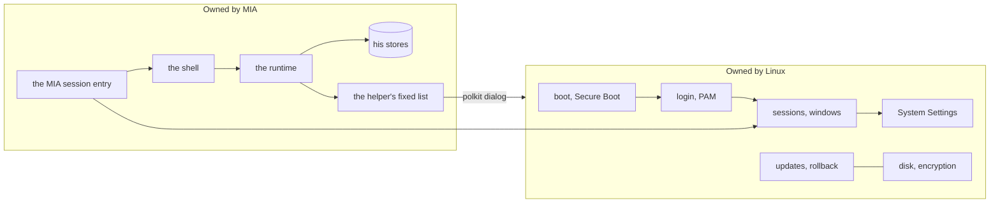

## 3. The runtime and its services

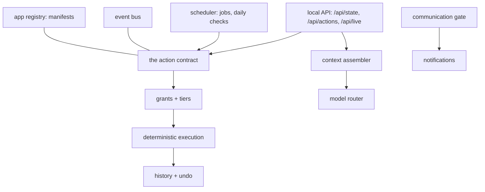

## 4. Intelligence and memory

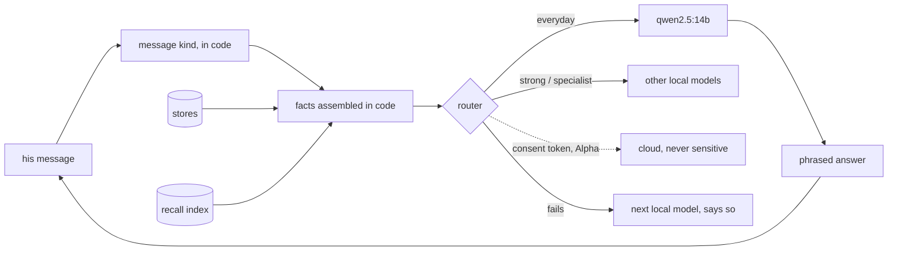

## 5. Autonomy and authorization

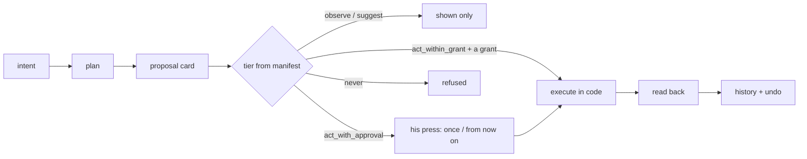

## 6. Application ecosystem

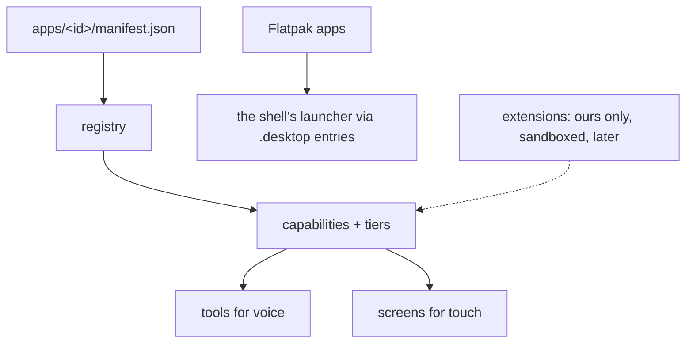

## 7. Desktop and graphics

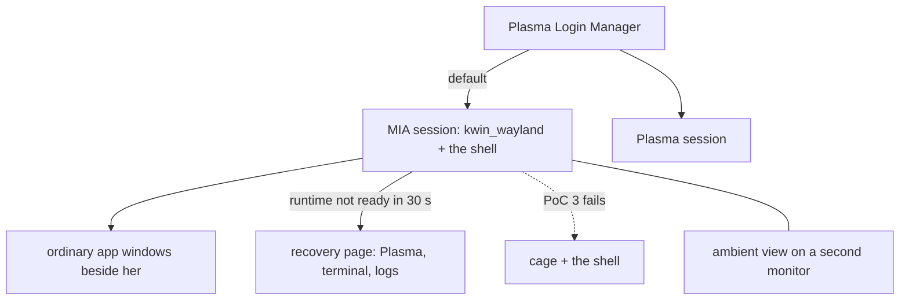

## 8. Devices

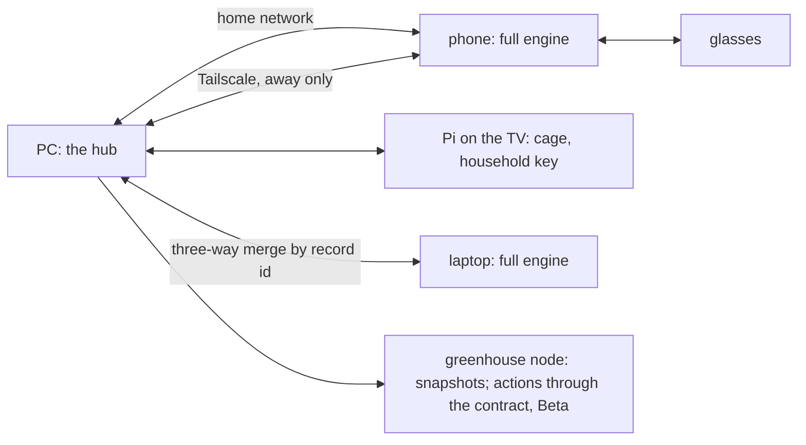

## 9. Security and trust boundaries

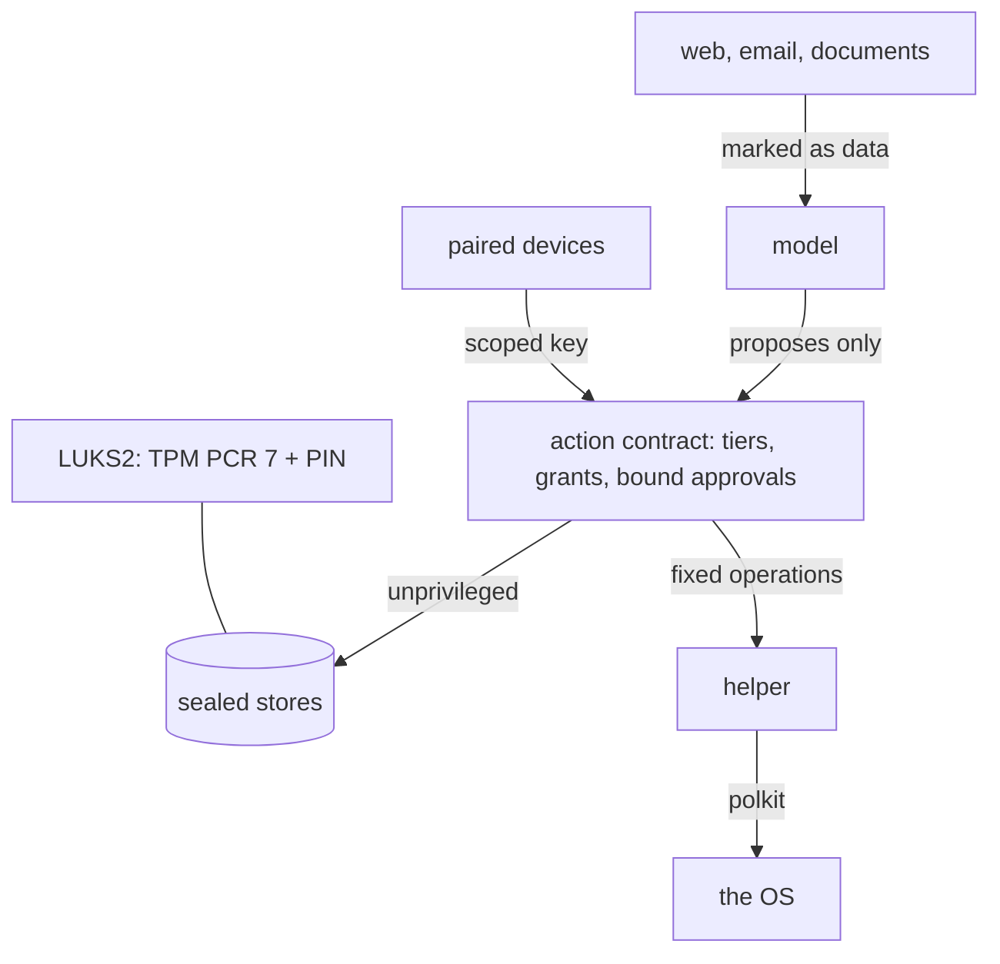

## 10. Boot and recovery

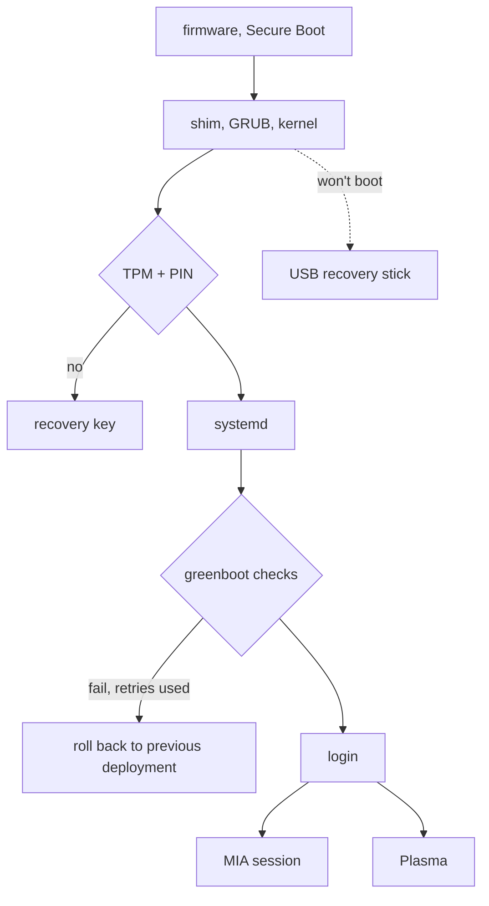

## 11. Build and release

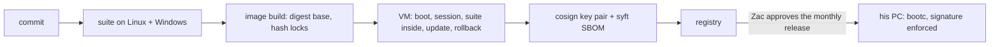

## 12. Milestones and dependencies

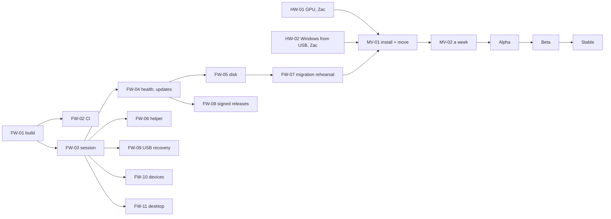

## 13. An interaction end to end

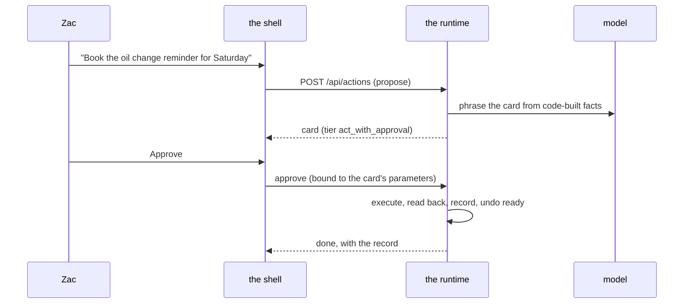

## 14. Data ownership and flow

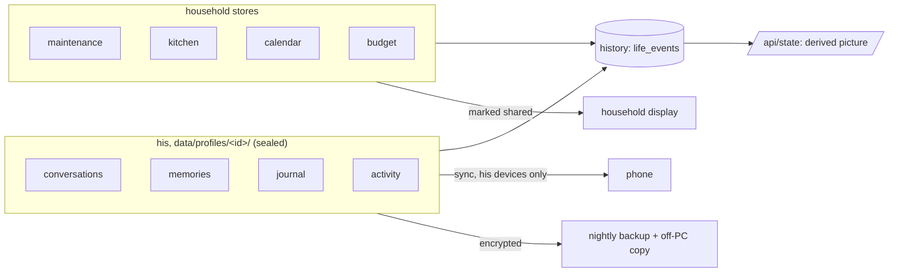

## 15. Control and authorization

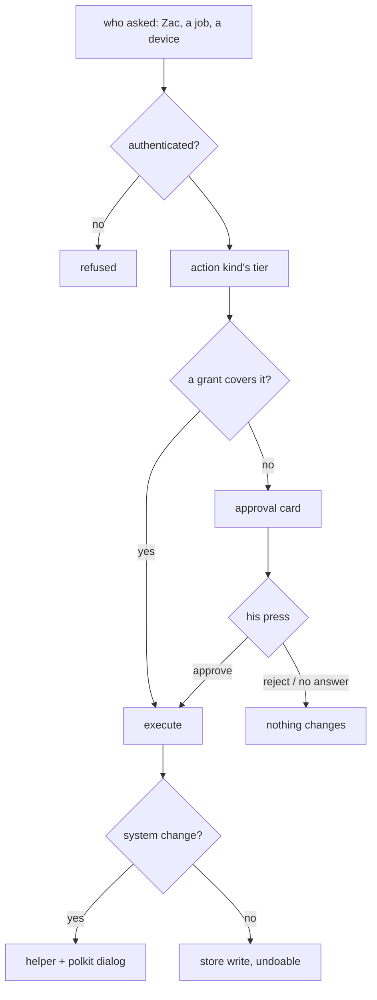
