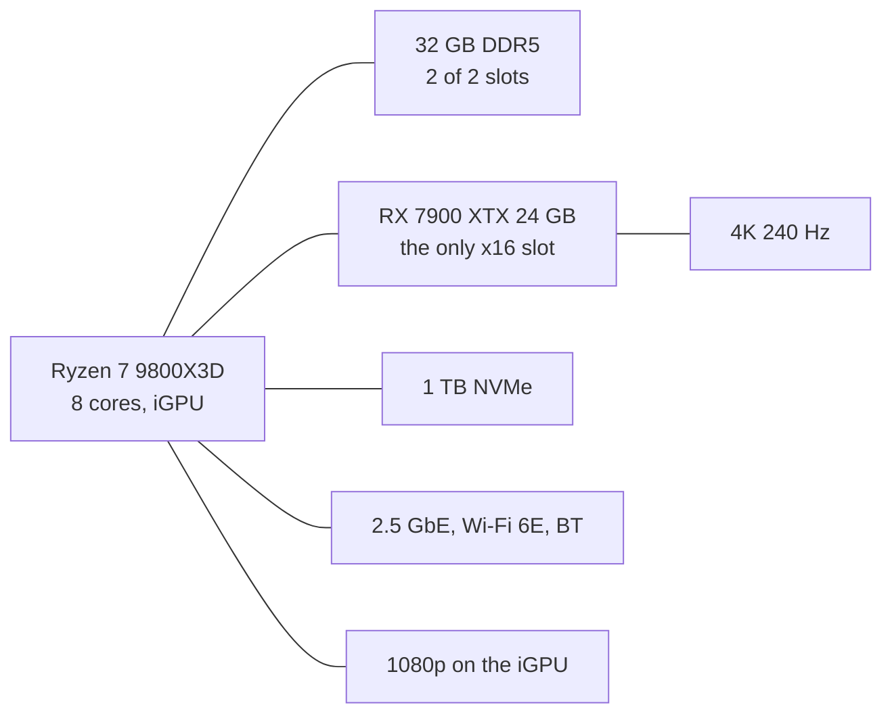
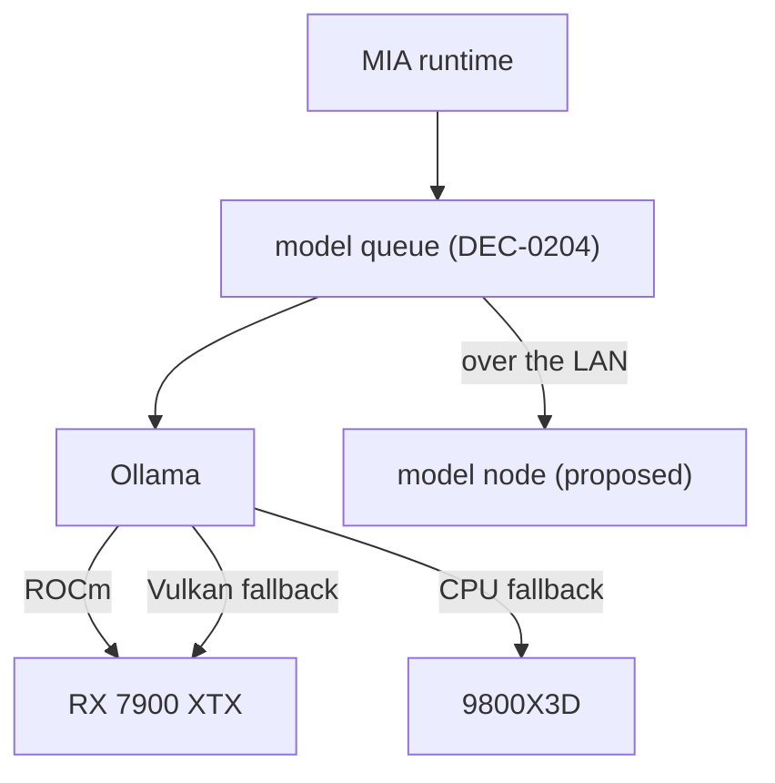
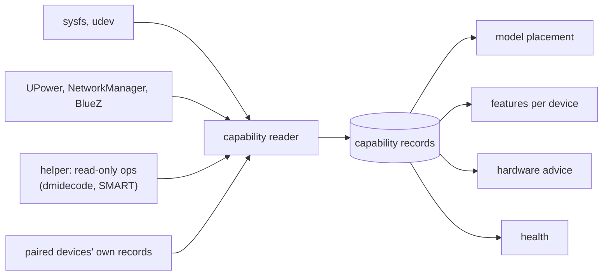
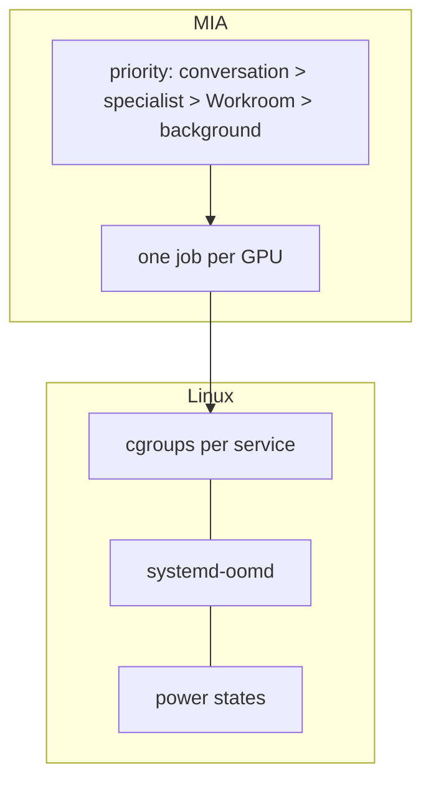
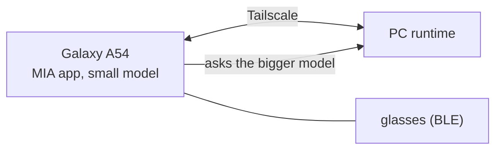
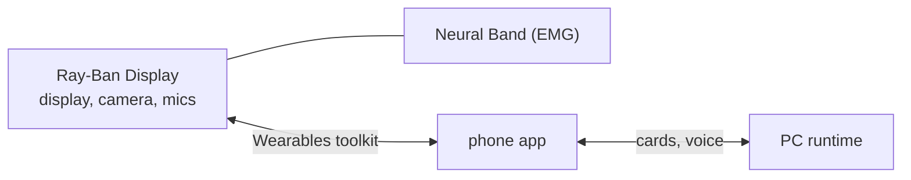
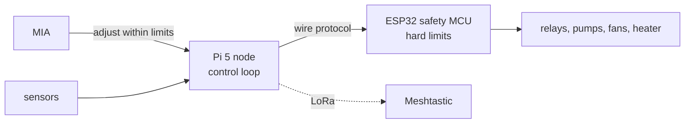
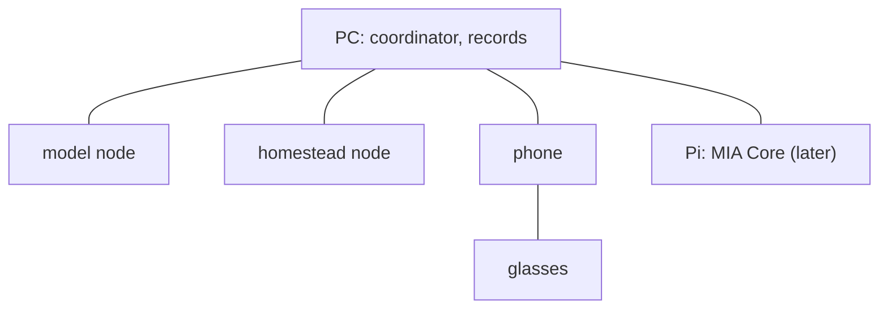
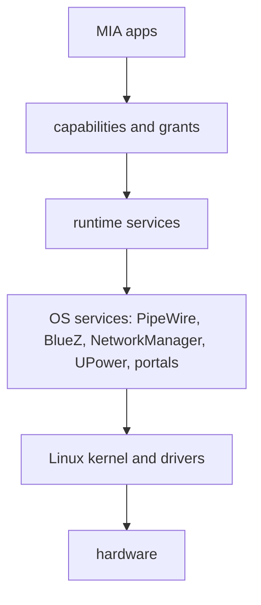
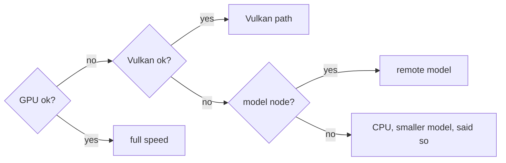

# MIA OS: hardware architecture diagrams (Prompt 06 §20)

*Claude (Opus), 2026-11-17. The ten diagrams the prompt asks for, in Mermaid (renders on GitHub).*

## 1. Primary workstation

## 2. CPU, GPU and AI acceleration

## 3. Discovery and the capability registry

## 4. Resource coordination

## 5. Android and the workstation

## 6. Glasses and spatial endpoints

## 7. Embedded and homestead

## 8. Distributed device network

## 9. Hardware abstraction layers

## 10. Failure and degraded operation

