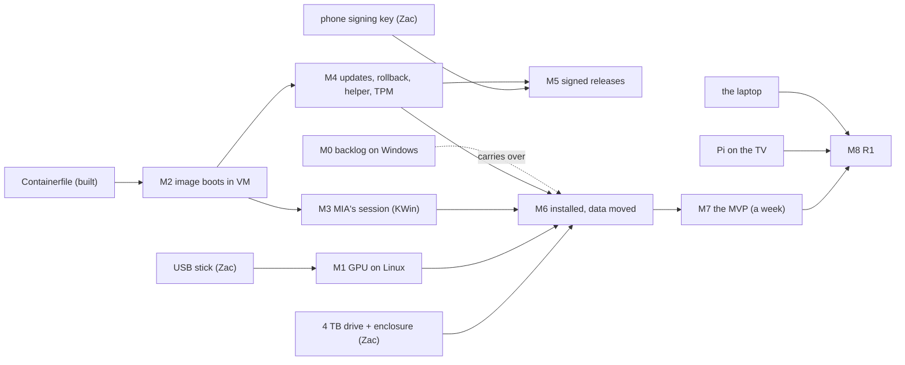

# MIA OS: what depends on what (Prompt 16)

> **Prompt 17 (2026-11-18):** superseded where it differs by `MIA_OS_FINAL_IMPLEMENTATION_ROADMAP.md`, `MIA_OS_FINAL_MVP_AND_RELEASE_DEFINITION.md` and `MIA_OS_FINAL_MIGRATION_AND_DATA_CONTINUITY_PLAN.md`. Corrections: proof of concept 2's headless boot, update and rollback **passed** on 2026-11-16 (GitHub run 43872077107), so "boot to do" is wrong; the login manager is Plasma Login Manager, not SDDM; DEC-0269, 0270 and 0272 are approved (`docs/DECISIONS.md`).

*Claude (Opus), 2026-11-18.*

Every arrow from a box marked Zac is his hands-on step; nothing else on the critical path needs buying.
