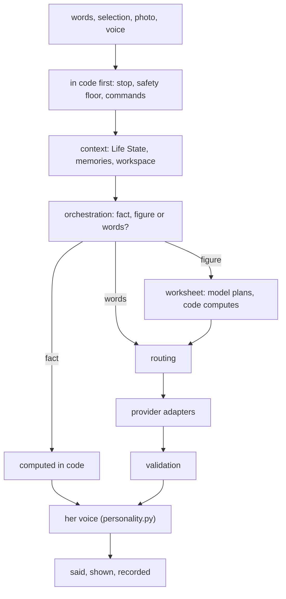
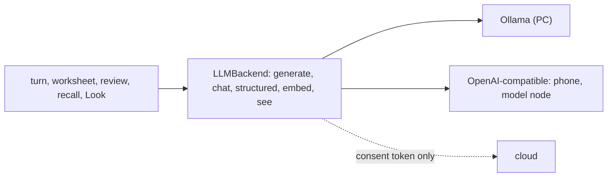
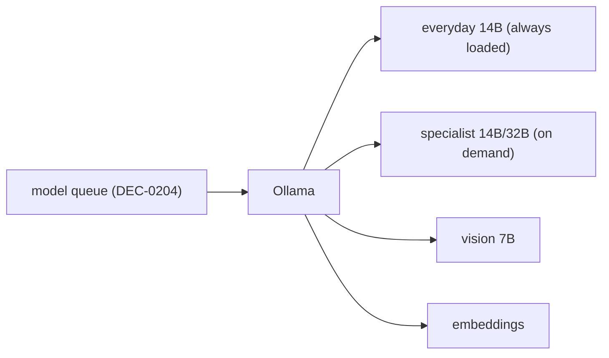
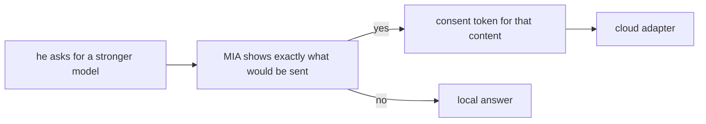
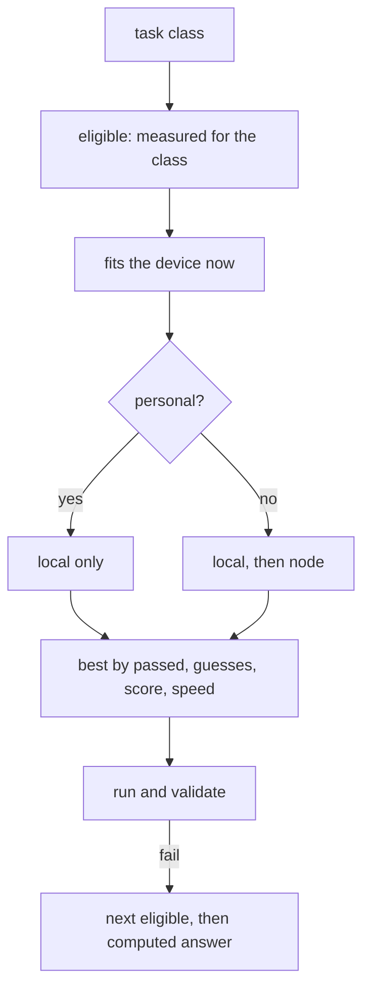
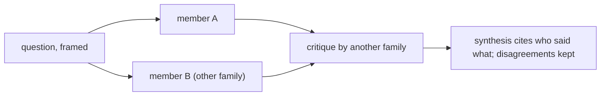
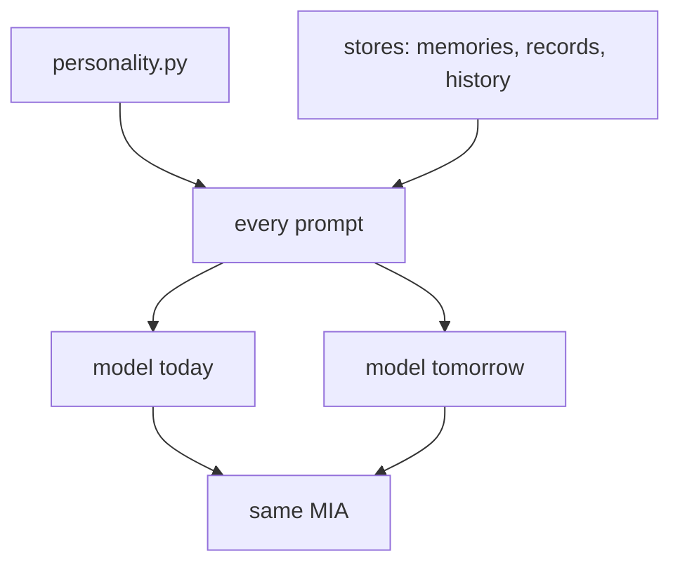
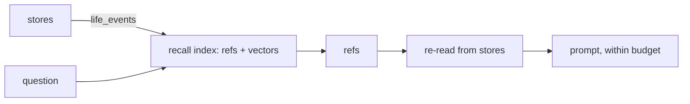
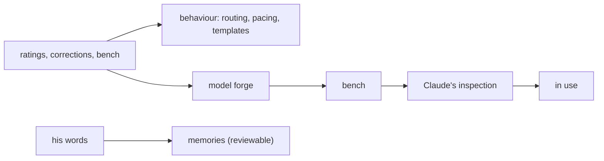
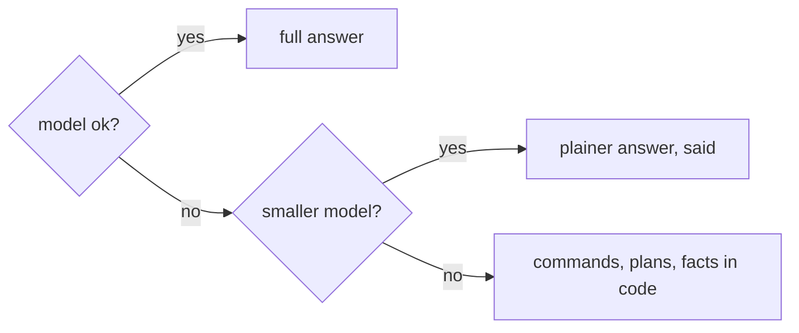

# MIA OS: intelligence architecture diagrams (Prompt 07 §20)

*Claude (Opus), 2026-11-17. Mermaid (renders on GitHub).*

## 1. The whole

## 2. The provider interface

## 3. Local inference

## 4. Cloud inference

## 5. Routing

## 6. Council

## 7. Identity and continuity

## 8. Memory and context assembly

## 9. Learning boundaries

## 10. Degradation

