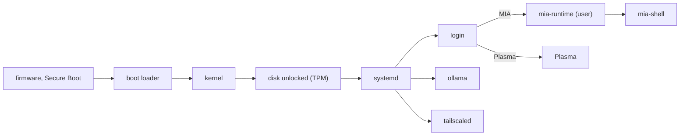
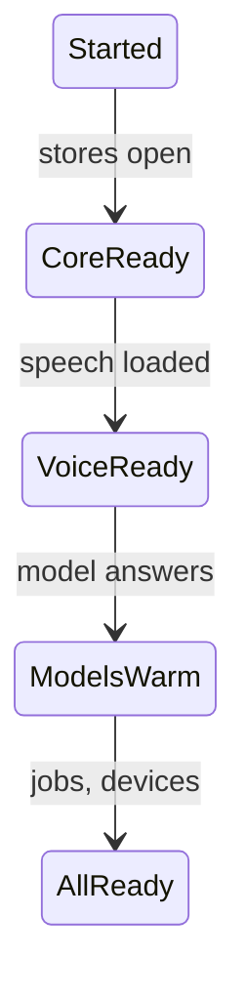
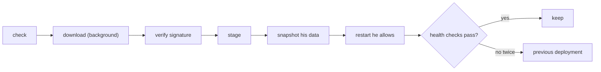
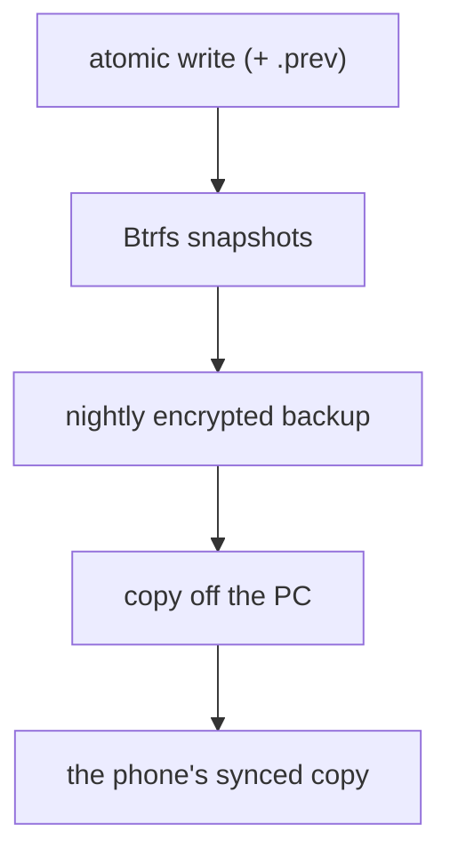
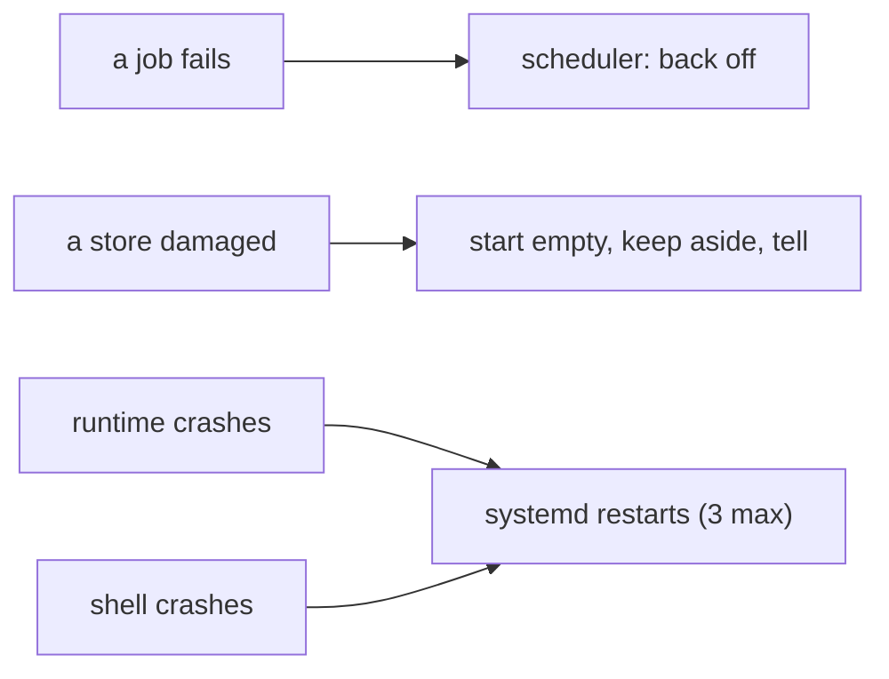

# MIA OS: reliability diagrams (Prompt 14)

*Claude (Opus), 2026-11-18. Mermaid.*

## 1. Boot

## 2. Readiness

## 3. An update

## 4. Data protection layers

## 5. Failure containment

## 6. Disaster recovery

