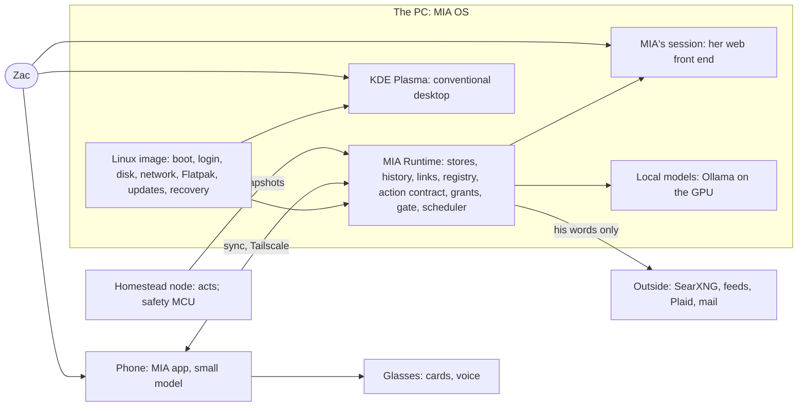
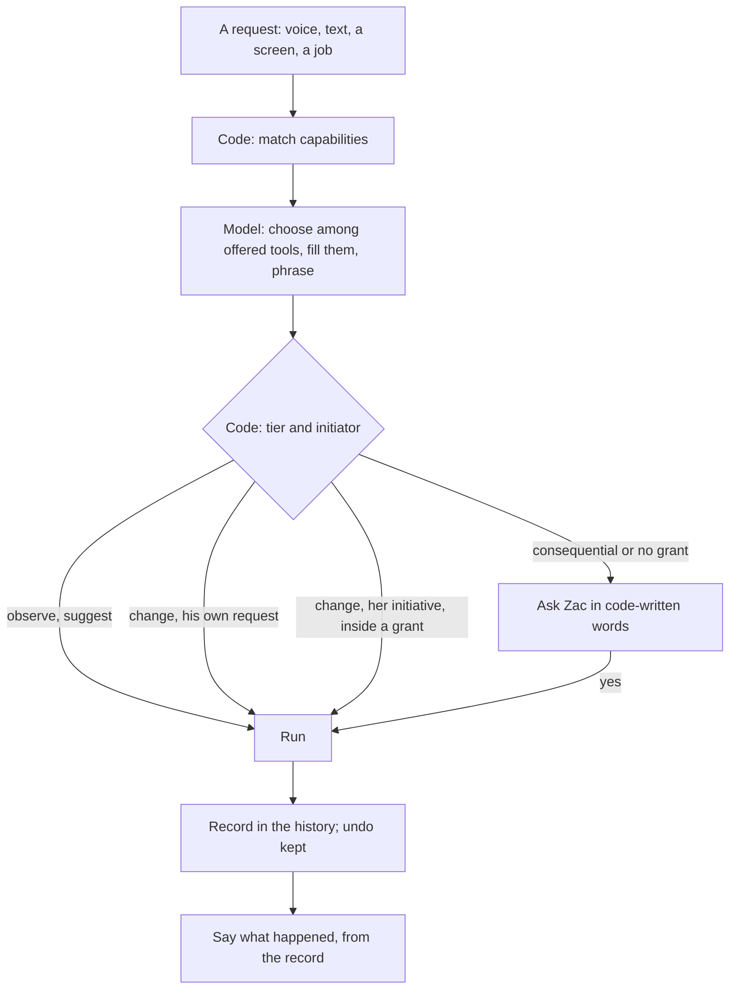
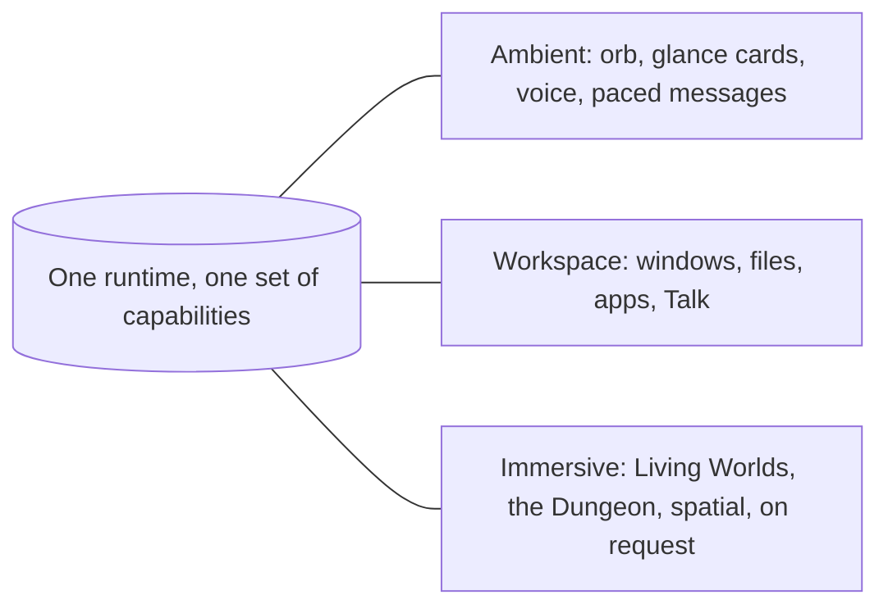
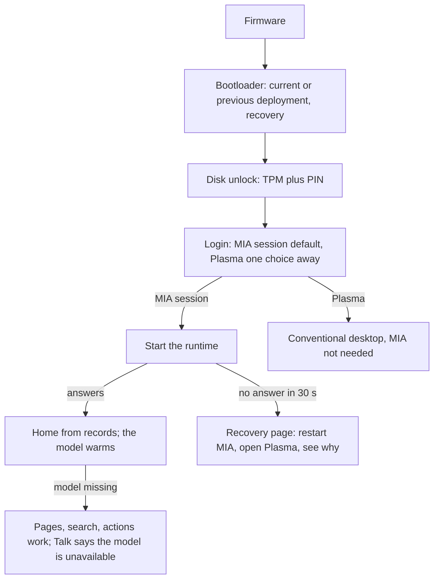
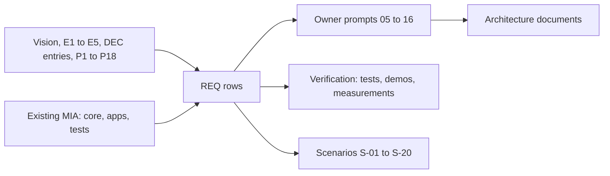

# MIA OS: requirements diagrams (Prompt 04, deliverable 16)

*Claude (Opus), 2026-11-15. Planning only. Mermaid diagrams; the text documents are authoritative where they differ.*

## 1. System context

## 2. Who decides what

## 3. Interaction modes over one runtime

## 4. Boot and degradation

## 5. Traceability, in outline

