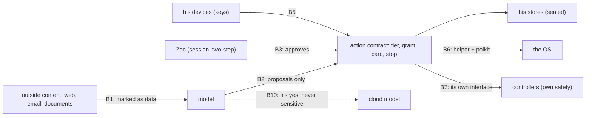
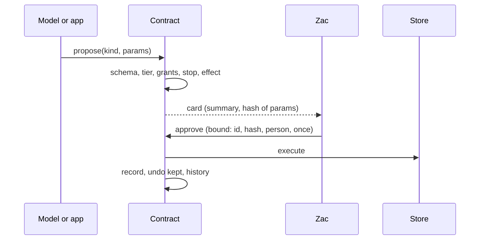
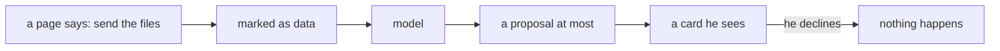
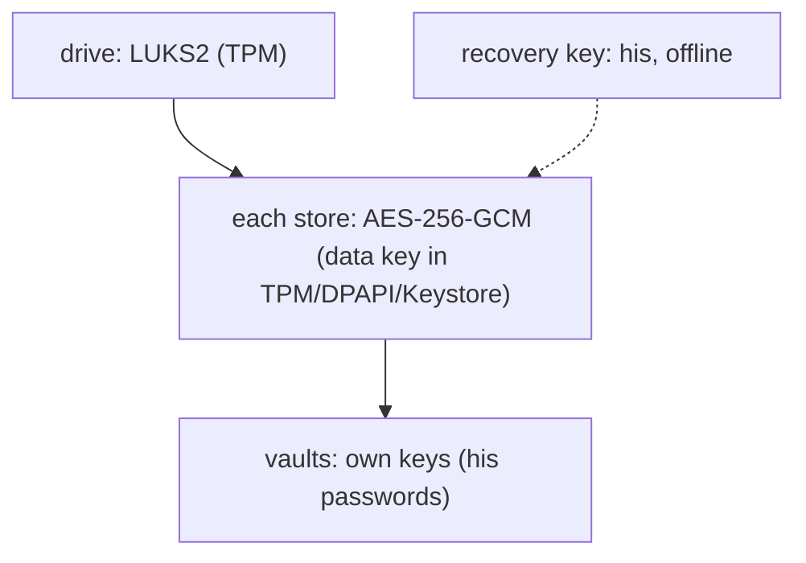
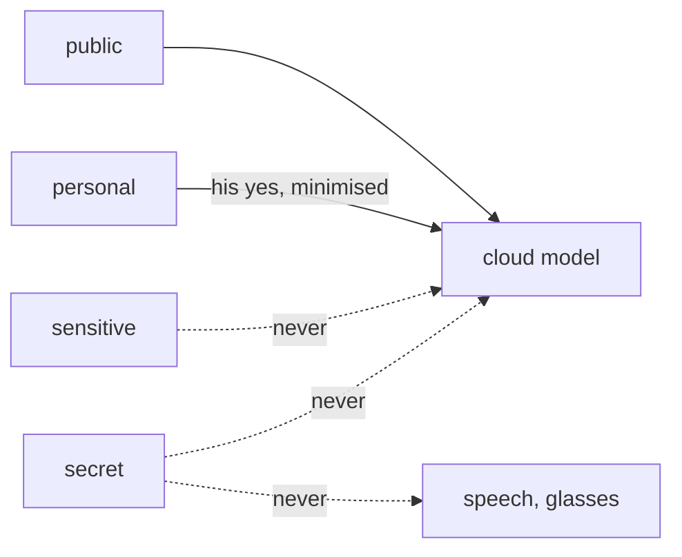
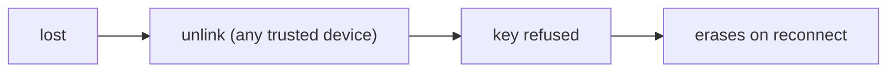
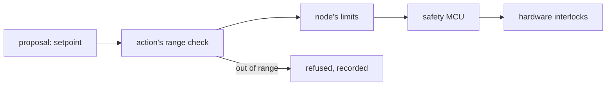
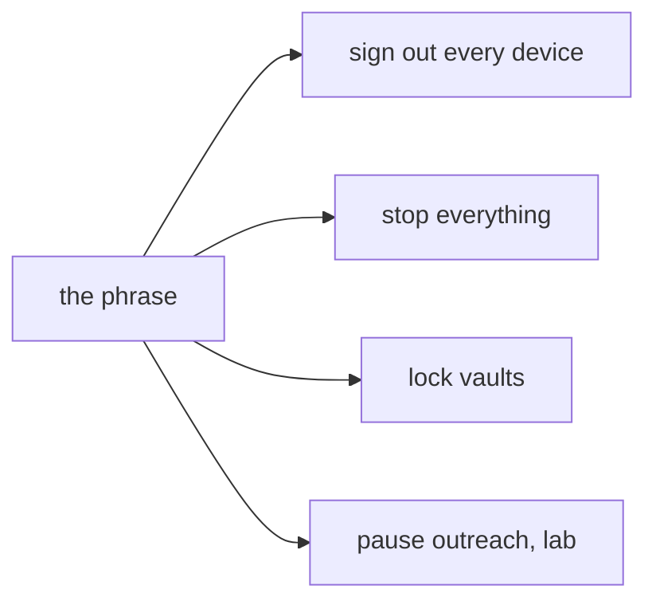

# MIA OS: security diagrams (Prompt 13 §27)

*Claude (Opus), 2026-11-18. Mermaid. Each diagram names the controls at its boundaries.*

## 1. The whole, with boundaries

## 2. An action from proposal to record

## 3. Prompt injection

## 4. Encryption layers

## 5. Data classes and where they may go

## 6. A lost phone

## 7. Physical command

## 8. Lockdown

The remaining views (agents, Linux privilege, sandboxing, household, supply chain, backups, monitoring) follow
diagram 1 and are tables in their documents.
