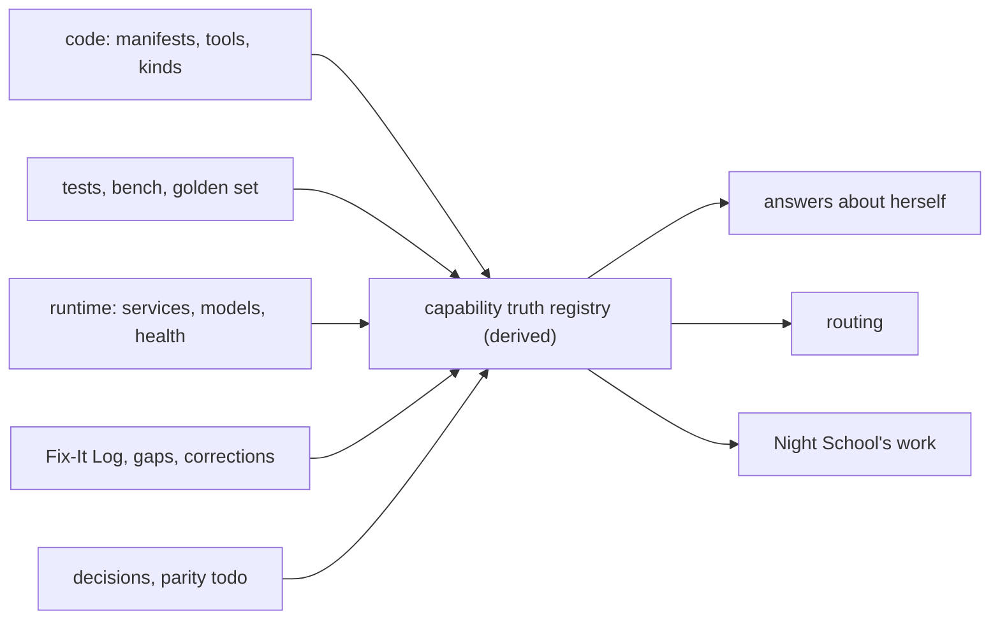
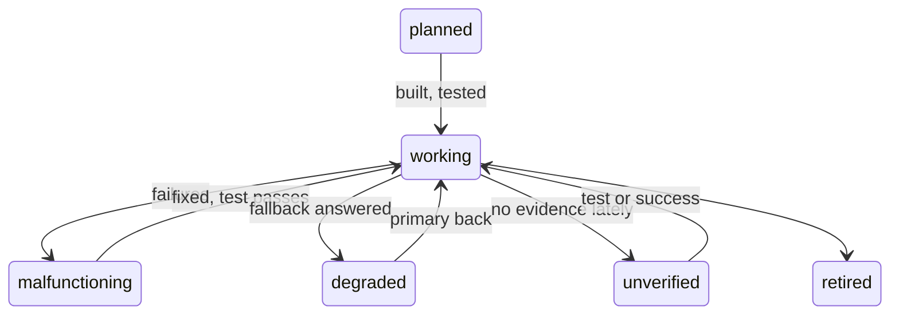
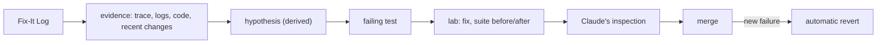
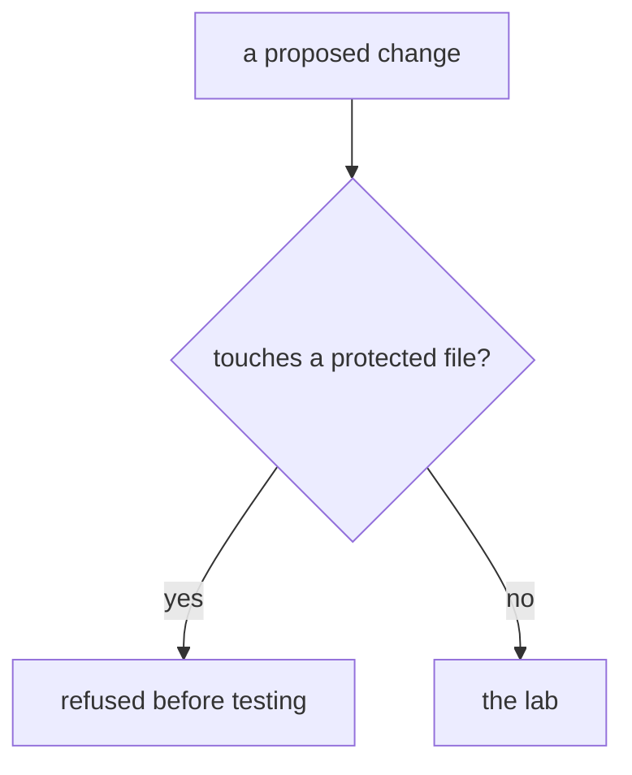

# MIA OS: self-awareness diagrams (Prompt 09 §20)

*Claude (Opus), 2026-11-17. Mermaid.*

## 1. The registry from its sources

## 2. Capability states

## 3. From failure to fix

## 4. What she may change

