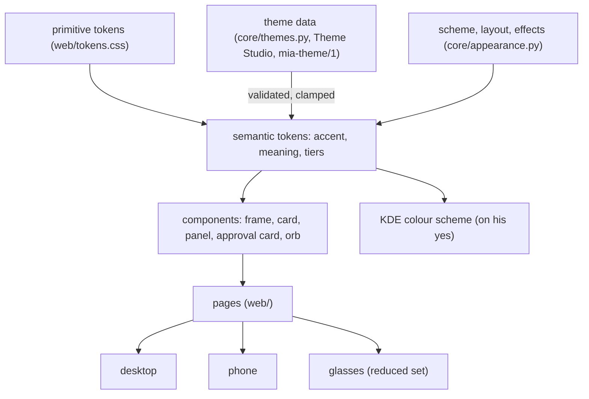
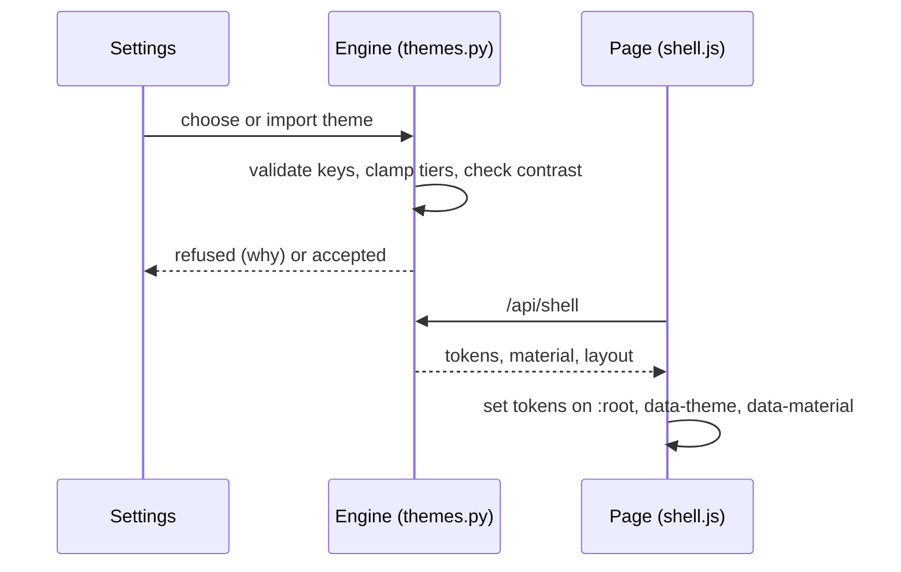
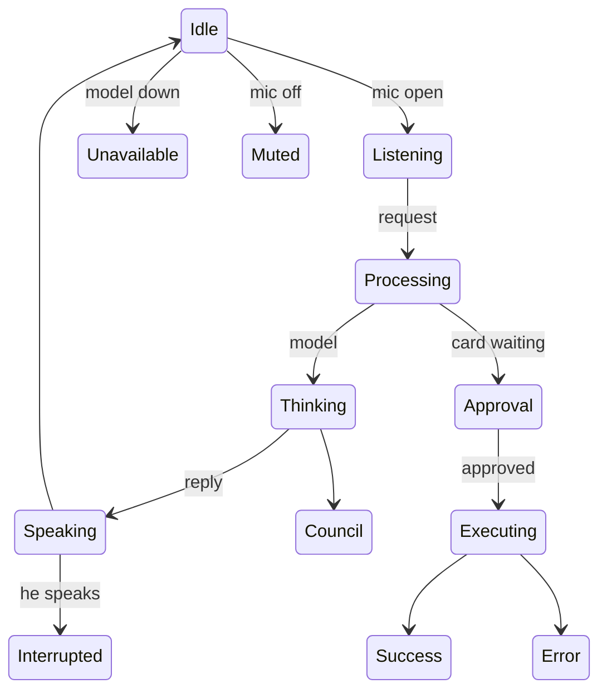
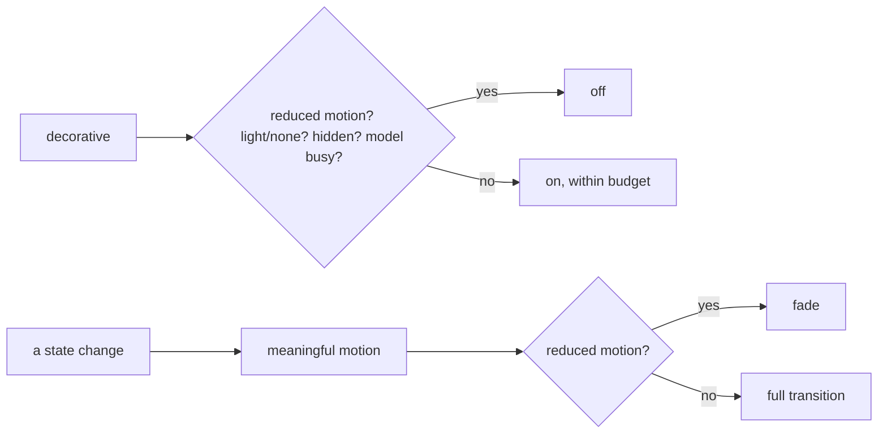
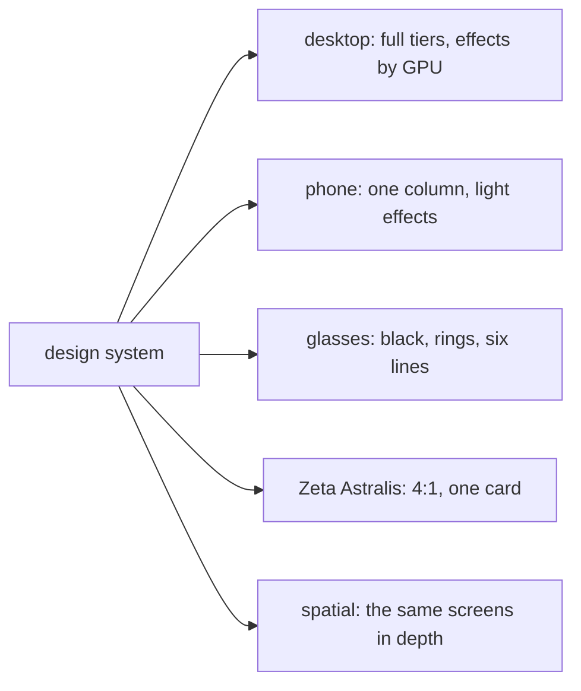
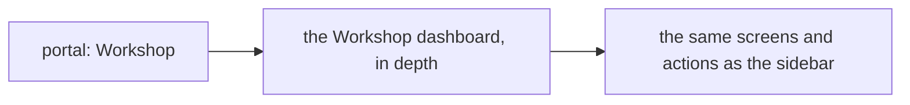
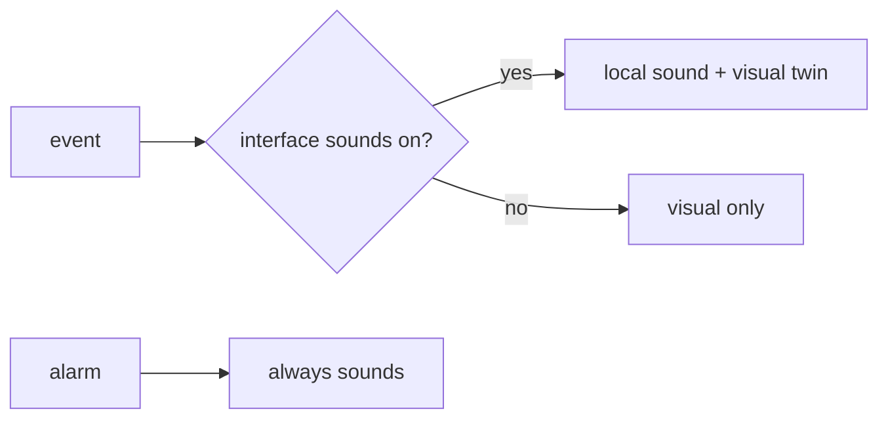

# MIA OS: visual architecture diagrams (Prompt 11 §22)

*Claude (Opus), 2026-11-17. Mermaid.*

## 1. The design system and its tokens

## 2. Theme loading

## 3. The orb's states

## 4. Motion and degradation

## 5. Devices

## 6. Spatial portals

## 7. Audio

The cross-application system and accessibility are the tables in their documents; each follows diagram 1.
